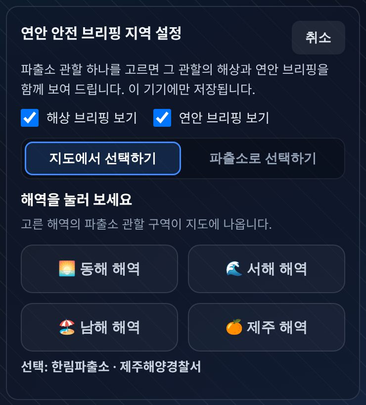
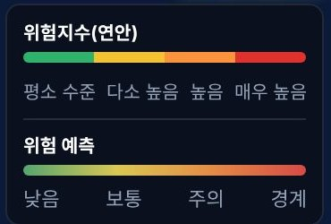
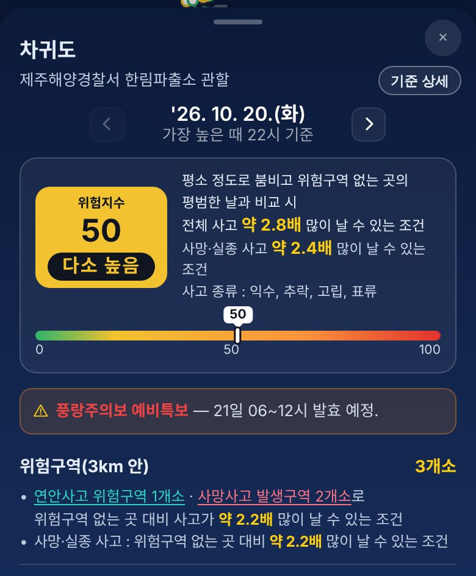
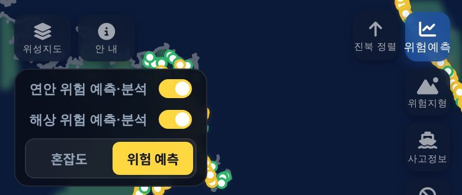

<!-- 패치노트 원본(작성 규칙: 저장소 NOTICE.md). 게시판에 올릴 파일은 `node scripts/notice/build_notice.js` 로 만든 patchnote.upload.md (사진이 파일 안에 들어감). 스크린샷: 2026-10-20 22:1x KST 운영 앱(390px 폭) — 지도 위성 배경은 작업 환경에서 받지 못해 어둡게 나옴. -->
# 새 기능 안내 — AI 연안 안전 브리핑 · 위험예측 지도

오늘 우리 지역 바다와 해안이 얼마나 위험한지 **한눈에** 볼 수 있는 기능 두 가지를 새로 열었습니다.

## 1. AI 연안 안전 브리핑

**무엇이 생겼나요?**

내가 고른 파출소 관할의 **오늘 바다(해상)와 해안가(연안) 상황**을 정리해 주는 브리핑입니다. 기상특보, 파도·바람 예보, 관광지 붐빔, 과거 사고 기록을 모아 **평소 수준 · 관심 · 주의 · 경계** 단계로 알려 드리고, 그 내용을 AI가 읽기 쉬운 문장으로 정리합니다.

**어디서 보나요?**

- **[특보정보] 탭** → 「기상청 해상 기상 전망」 아래 **「AI 연안 안전 브리핑」**을 눌러 펼치세요.
- 처음이면 오른쪽 **⚙ 버튼**으로 지역을 고르세요. 지도에서 해역을 누르거나, 파출소 이름으로 고를 수 있습니다.
- 하루 세 번(**07:30 · 17:30 · 23:00**) 새로 나오고, 특보가 바뀌면 다시 만들어집니다.
- 브리핑에 나온 관광지·해역 이름을 누르면 지도로 위치를 함께 볼 수 있습니다.

**이런 점이 좋아요**

바다에 나가기 전, 오늘 우리 지역에서 **특히 조심할 해변·관광지와 바다 상황**을 짧게 확인할 수 있습니다.

## 2. 해양안전생활 — 위험예측 지도

**무엇이 생겼나요?**

전국 해안 관광지(연안)와 바다(해상)의 위험 정도를 **지도에 색으로** 보여 줍니다.

- **연안**: 관광지마다 위험지수(0~100). 날씨·특보·붐빔·위험구역·과거 사고를 함께 따집니다.
- **해상**: 바다 칸마다 해양사고 위험 예측과 선박 혼잡도.

**어디서 보나요?**

- **[해양안전생활] 탭** → 지도 오른쪽 위 **[위험예측]** 버튼을 누르세요.
- 연안은 위쪽 날짜 줄의 **〈 〉** 로 오늘·내일을 넘겨 볼 수 있습니다.

- 관광지 점을 누르면 아래에서 **상세 정보**가 올라옵니다. 위험지수, 평소보다 사고가 얼마나 날 수 있는 조건인지, 특보, 근처 위험구역을 볼 수 있습니다.

- 바다를 보려면 **「해상 위험 예측·분석」** 스위치를 켜고 **[혼잡도]** 또는 **[위험 예측]**을 고르세요. 아래 시간 버튼으로 몇 시간 뒤도 볼 수 있습니다.

**이런 점이 좋아요**

가려는 해변·관광지가 오늘 얼마나 위험한지, 나갈 바다가 붐비거나 위험한지를 **미리** 알 수 있습니다.

> 이 정보는 기상청 등 공공 자료를 바탕으로 한 예측이라 실제 현장 상황과 다를 수 있습니다.
