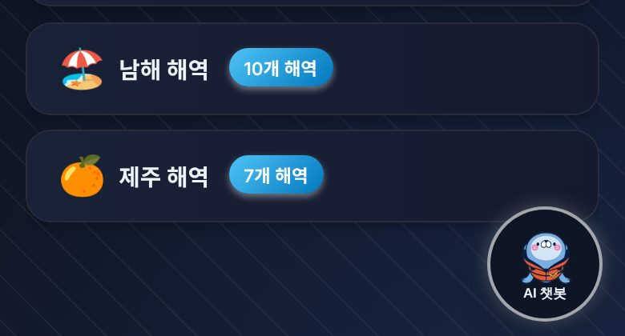
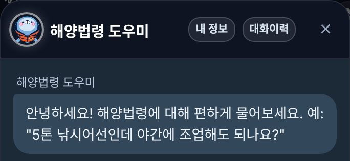
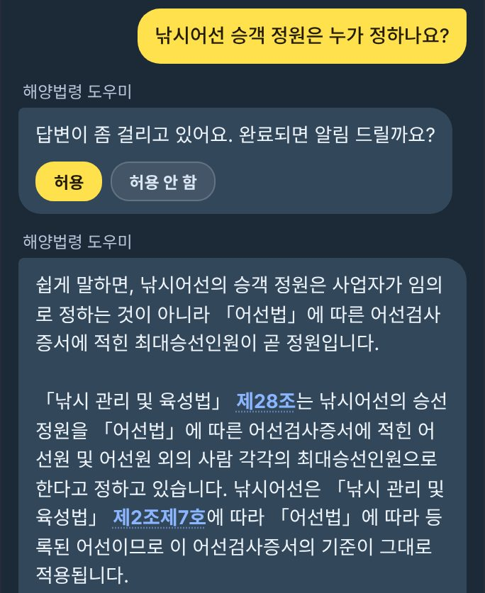
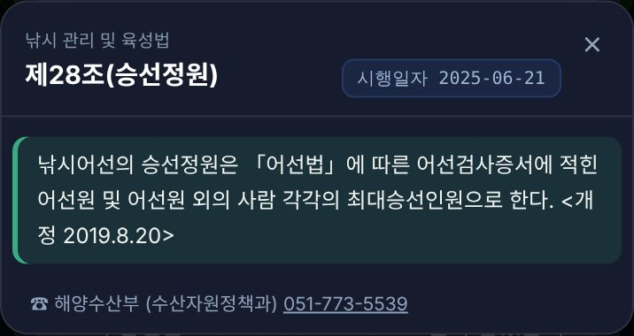
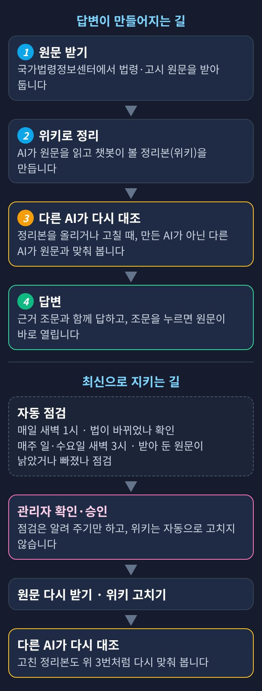
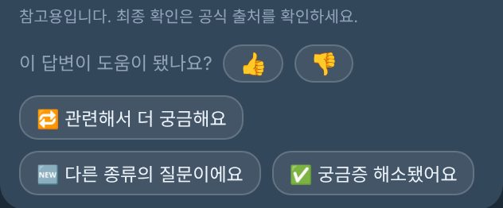
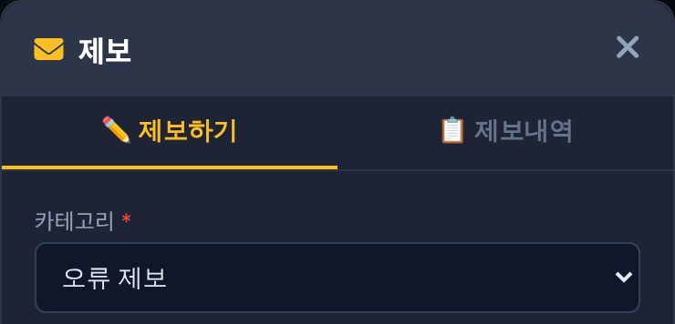

<!-- 패치노트 원본(작성 규칙: 저장소 NOTICE.md). 게시판에 올릴 파일은 `node scripts/notice/build_notice.js` 로 만든 patchnote.upload.md (사진이 파일 안에 들어감).
     글①(오픈 안내)·글②(챗봇 소개)를 사장님 지시(2026-11-03 「하나로 모두 만들어야 될 것 같아」)로 한 파일에 합침.
     스크린샷: 2026-11-03 05:2x KST 운영 앱(390px 폭·2배). 질문 1번(「낚시어선 승객 정원은 누가 정하나요?」 — 사장님 허락). 방문·설문·그 밖의 POST 는 route 로 막음. 제보 창은 열기만 하고 제출하지 않음.
     8_structure.jpg 는 같은 폴더 diagram.html 을 318px 폭·2배로 찍은 구조도.
     근거(2026-11-03 확인):
       챗봇 이름 = client/js/ai-chat/ai_chat.js 3159행 nrya-chat-name 「해양법령 도우미」 · 버튼 「AI 챗봇」(같은 파일 3152행) · [특보정보] 탭에서만 보임(MAIN_TAB_GROUP 'weather-group', updateFabVisibility) · 운영 /api/legal/config exposure "user"
       점검 시각 = local_server/server.js cron '0 1 * * *'(개정 감지) · '0 3 * * 0'(원문 신선도) · '0 3 * * 3'(원문 결손) — 셋 다 timezone 'Asia/Seoul'
       위키 자동 수정 안 함 = services/legal_amendment_scanner.js · admrul_fresh_scanner.js 머리 주석(사람 승인 게이트)
       다른 AI 재대조 = knowledge/legal/_SCHEMA.md §5-D ⓐ3(올릴 때 만든 에이전트가 아닌 다른 눈) · _RULES.md V5-57 reread_guard.js(고친 canonical 은 다른 에이전트가 읽어야)
       ⚠ 2026-10-08 기록상 다른 눈의 읽기 기록 없이 canonical 인 쪽이 남아 있다(reread_guard.js 머리 주석) → 글은 「올리거나 고칠 때」 규칙으로만 씀
       조문 팝업 = 원문(raw)에서 뽑음(services/article_text.js) · 시행일자·담당 부서 전화번호 표시(화면 확인)
       모르는 말 = legal_retriever.js naverTermStep(위키·원문 직독 모두 빈손일 때만) · naver_search.js searchTermMeaning(백과사전·지식iN·카페) · 법적 근거로 안 씀(naver_search.js 불변식) · 운영 config naverTermLookup true
       한/영 자판 = naver_search.js correctTypo(일반 맞춤법 아님) · legal_retriever.js 5589행(로마자가 섞인 낱말일 때만)
       답변 평가 = ai_chat.js feedbackHTML 「이 답변이 도움이 됐나요?」 👍/👎 · 👎 「어떤 점이 아쉬웠나요? (선택)」
       오류 제보 = index2.html #header-report-btn(봉투 아이콘, title 「오류 제보」) → 창 제목 「제보」 · 카테고리 「오류 제보」 · [제보 제출하기] (engagement/report_user.js)
       댓글 = 게시글마다 관리자가 「댓글 허용」을 켜야 보인다(promo.js 713행 · promo_comment5.js — 기본 꺼짐)
       법령 수 = 같은 폴더 make_law_list.py(기준 법률 = wiki/statutes 74개 · collect_eval.js 정의) → law_list.csv · 해양법령도우미_법령목록.pdf -->
# 새 기능 안내 — AI 법령 챗봇 「해양법령 도우미」

바다·어업·선박 법령을 물으면 **근거 조문과 함께** 답하는 AI 챗봇을 임시로 열었습니다.

## 1. 해양법령 도우미를 열었습니다

### 무엇이 생겼나요?

- 바다 관련 법령을 **평소 말로 물으면** AI가 근거 조문을 찾아 답합니다.
  - 조문을 누르면 그 원문을 바로 볼 수 있습니다.

### 왜 지금 여나요?

- 그동안 계속 만들어 왔지만 **AI 호출 비용** 때문에 공개하지 못했습니다.
- 「전국민 AI 경진대회」 활용 부문 심사(11월 1일부터)에 맞춰, 여러분도 써 보시도록 ==임시로== 열었습니다.
- 지금도 계속 다듬는 중입니다. 써 보시고 의견을 주시면 반영하겠습니다.
- !!운영 시간 안내!! AI 호출 비용 사정에 따라 운영 시간이 탄력적으로 바뀔 수 있고, 일찍 마감되거나 잠시 중지될 수 있습니다.

## 2. 어디서 쓰나요?

- **[특보정보] 탭** 오른쪽 아래 ==AI 챗봇== 버튼을 누릅니다.

- **「해양법령 도우미」** 창이 열리면 아래 칸에 질문을 쓰고 ➤를 누릅니다.
  - 위쪽 [대화이력]에서 지난 대화를 다시 볼 수 있습니다(이 기기에만 저장).

- 답변 속 **파란 조문 글씨**(예: 제28조)를 누르면 그 조문 원문이 열립니다.
  - 답이 오래 걸리면 끝났을 때 알림을 받을지 묻습니다.

- 원문 창에는 시행일자와 **담당 부서 전화번호**도 함께 나옵니다.

## 3. 어떻게 만들고, 어떻게 최신을 지키나요?

### 어떻게 만드나요?

- 국가법령정보센터 원문을 받아, AI가 챗봇용 정리본(위키)으로 정리합니다.
- 정리본을 올리거나 고칠 때는 **만든 AI가 아닌 다른 AI**가 원문과 다시 맞춰 봅니다.
- 답변은 이 정리본을 바탕으로 하고, 조문은 원문 그대로 보여 드립니다.

### 어떻게 최신을 지키나요?

- 매일 새벽 1시 법이 바뀌었는지 자동으로 확인합니다.
- 매주 일·수요일 새벽 3시 받아 둔 원문이 낡았거나 빠졌는지 점검합니다.
- 점검은 알려 주기만 합니다. ==관리자가 확인·승인==한 뒤 원문을 다시 받고 정리본을 고칩니다.

## 4. 이런 점이 특별해요

- **근거 조문 보기**: 답변 속 조문을 누르면 원문·시행일자·담당 부서 연락처가 바로 뜹니다.
- **모르는 말 확인**: 정리본에 없는 평소 말은 네이버 검색(백과사전 등)으로 뜻을 찾아 먼저 되묻습니다.
  - 「혹시 ○○ 말씀이신가요?」처럼 확인한 뒤 다시 찾습니다.
  - 찾은 뜻은 낱말 확인에만 쓰고, 법적 근거로는 쓰지 않습니다.
- **한/영 자판 실수 바로잡기**: 그 낱말을 한글 모드를 깜빡하고 영문으로 쳤다면 한글로 바꿔 찾습니다.
  - 일반 맞춤법 교정은 아닙니다.
- **원문 자동 점검**: 매일·매주 원문이 낡거나 빠진 곳을 찾아 관리자에게 알립니다.
- **답변 평가**: 답변 아래 「이 답변이 도움이 됐나요?」에서 👍·👎를 누릅니다.
  - 👎를 누르면 아쉬운 점을 적어 보낼 수 있습니다.

## 5. 어떤 법령이 들어 있나요?

- 해양 분야 법률 **74개**는 전문(모든 조문)을 갖고 있고, 시행령 73개(1개는 일부 조문만)·시행규칙 65개도 들어 있습니다.
- 해양 법률이 끌어다 쓰는 다른 부처 법령 484개(이 중 342개는 **일부 조문만**), 국제 협약 16개도 들어 있습니다.
- 고시·훈령 등 행정규칙은 860건이 넘습니다(목록에는 개수만).
- 전체 목록은 ==첨부 파일 「해양법령 도우미 법령 목록」(PDF)==에서 보실 수 있습니다.

## 6. 꼭 알아 두세요

- !!AI는 실수를 할 수 있습니다.!!
- 중요한 내용은 **근거 조문**이나 **국가법령정보센터**에서 한 번 더 확인하시기를 권고합니다.
- 목록에 「일부 조문만」으로 표시된 법령은 받아 두지 않은 조문에 답하지 못할 수 있습니다.

## 7. 의견은 이렇게 보내 주세요

- 이 게시글 **댓글**로 남겨 주세요.
- 또는 화면 맨 위 오른쪽 **봉투 단추(오류 제보)** → 「제보」 창 → 카테고리 ==오류 제보==를 고르고 [제보 제출하기]를 누릅니다.

## 8. 앞으로의 계획

- 정부 「AI 정부 실험실」에서 고성능 VM(가상 컴퓨터)을 **내년쯤 제공할 계획이라고 합니다**(담당자 문의 결과).
- 제공되면 그 위에 **해양 법률 전문 로컬 LLM**(우리가 직접 돌리는 AI)을 올려, 여러분이 ==무료로== 쓰실 수 있게 만들 계획입니다.
- 이 계획은 경진대회와는 별개입니다.

> !!참고!! AI는 실수를 할 수 있습니다. 중요한 내용은 근거 조문이나 국가법령정보센터에서 한 번 더 확인하시기를 권고합니다.
