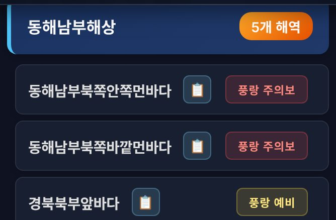
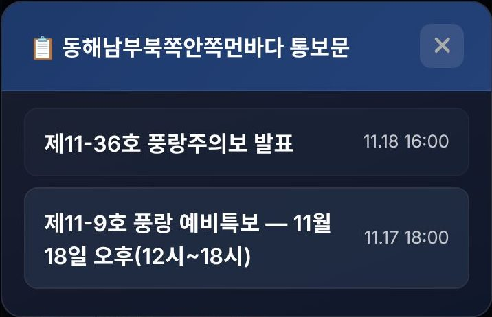
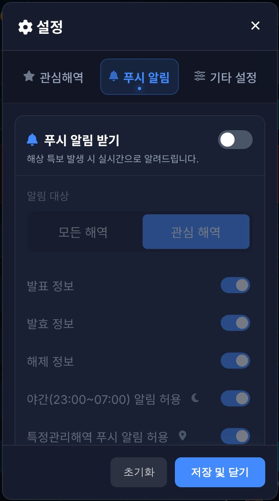
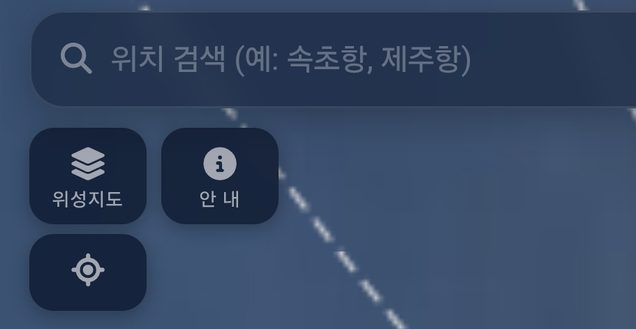
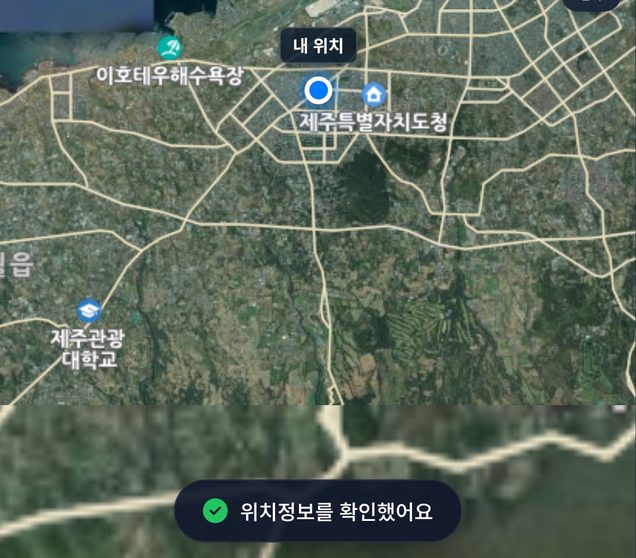
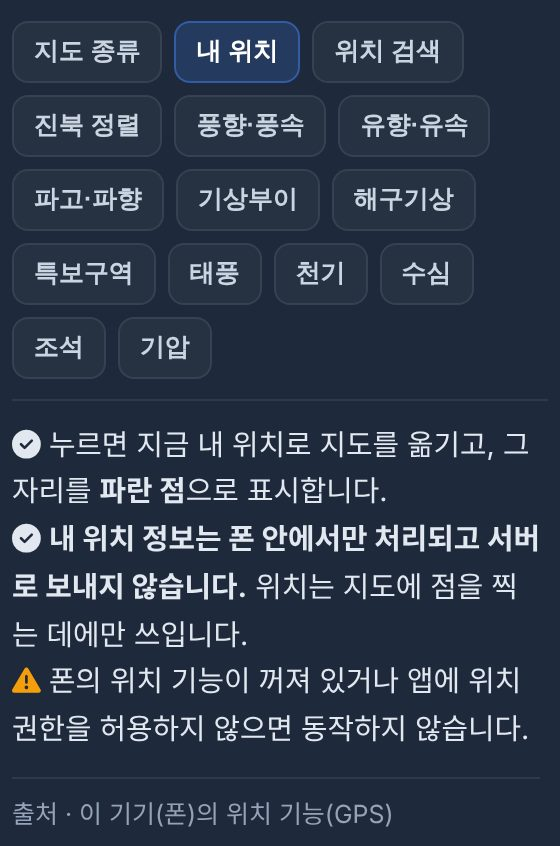
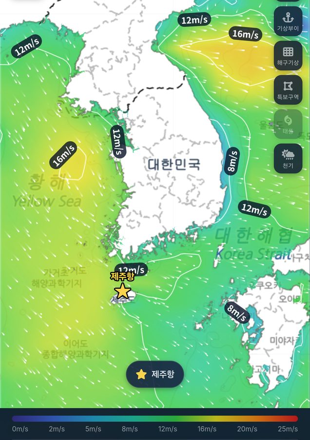
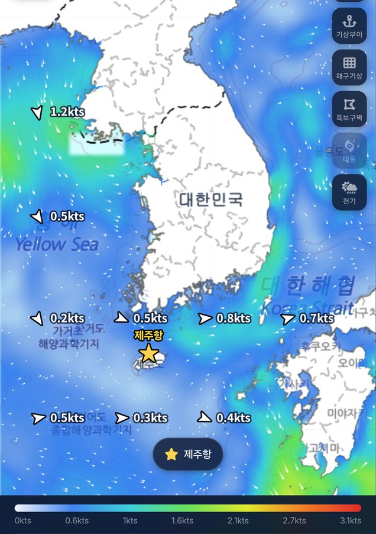
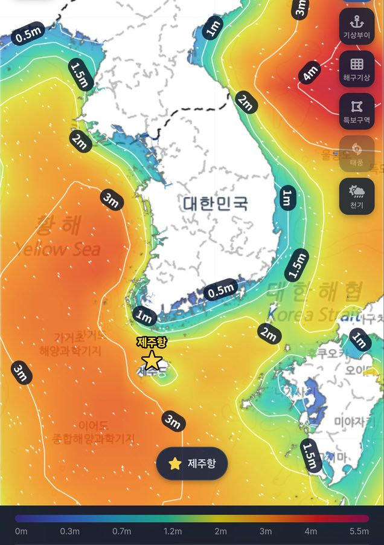

<!-- 패치노트 원본(작성 규칙: 저장소 NOTICE.md). 게시판에 올릴 파일은 `node scripts/notice/build_notice.js` 로 만든 patchnote.upload.md.
     범위: main 커밋 2026-11-04 ~ 2026-11-18 KST(비머지 581건) 중 사용자 체감분 + 사용자가 지정한 진행 중·향후 계획·서버 관리 항목.
     문구는 사장님과 대화로 확정(2026-11-18).
     스크린샷: 1·2·3·6 = 2026-11-18 20:1x KST 운영 앱(390px 폭·2배, 방문·설문·POST 는 route 로 막음, 저장 버튼 안 누름).
       3(푸시 알림 탭)은 휴대폰 앱에서만 보이는 탭이라 화면 판정(window.Capacitor.isNativePlatform)만 앱처럼 바꿔 찍음 — 화면 모양은 앱과 같은 index2.html.
       4·5·7·8·9 = 사장님이 휴대폰으로 직접 찍어 준 화면(작업 환경에서는 지도 배경이 안 나와서)을 잘라 씀.
     근거(2026-11-18 확인):
       1 통보문 = 41f7b6fac(발자취·해제 뒤 버튼 없음) · 671b1aa2b(PDF 없으면 본문 글)
       2 푸시 표기 = 6b80720e9 · f4cef0438(종류 격상/격하 문구)
       3 푸시 끔 유지 = 66757ae3d · 0fbcb6b43 — 수정 전 되돌아간 기기는 복구 못 함(커밋 [한계]) → 다시 끄기 안내.
         화면 이름: index2.html 머리 ⚙(title 「앱 설정」) → 설정 창 「푸시 알림 받기」 스위치(#push-master-toggle) → [저장](settings.js)
       4 내 위치 = 58296b17f · 985e4e6bd · 735bb05c6(「내 위치 정보는 폰 안에서만 처리되고 서버로 보내지 않습니다」) · 버튼 「내 위치」·「기본맵」(index2.html)
       5 지도 숫자 = 36f9352f9 · 버튼 「풍향·풍속」「파고·파향」「유향·유속」(index2.html)
       6 항행경보 = 5527710f4(로컬 재현 0건 → 44건) · 해양안전(해양안전생활 하위탭)에서만 보이는 「항행경보」 버튼
       7 조석 수집 = 10b0ce21d(23:30 → 02:00 KST). ⚠커밋에는 「겹칠 수 있었다」·「23:30대 실제 실패 기록 확인 못 함」 — 「조회되지 않던」 문구는 사장님 지시대로.
       8 브리핑 = 6a6952749 · 9e12d5558 · 5d7d0d0b6 · 제목 「AI 연안 안전 브리핑」(index2.html #station-briefing-title)
       진행 중 = ff0f5fd8d · 286e4d368(MMIS 자식 해역 상태) · b06963417(통보문 기준 시험, 관리자만)
       향후 계획·부재 기간 = 사장님 제공(2026-11-18)
       서버 = af4e770f8(볼륨 2GB 증설) · c5708f773(메모리 1GB→2GB) · 6b0dda25a·21ae72c71(나리야 자동 반영) · bd8adee46(Claude·Upstage)
       챗봇 화면 이름 = 「해양법령 도우미」(docs/notice/2026-11-03_law-chatbot-open — ai_chat.js nrya-chat-name). 「계속 운영」은 사장님 결정. -->
# SEA:GNAL 업데이트 안내

지난 2주 동안 고친 내용과 앞으로의 계획을 알려드려요.

## 🌊 특보 관련

### 1. 특보 통보문 보기 개선

- 「해역별 특보현황」에서 통보문을 누르면 ==특보 시작부터 해제까지== 순서대로 보여요.
- 특보가 해제되면 통보문 버튼은 사라져요.
- 원문 PDF가 아직 없는 통보문은 빈 화면 대신 본문 글을 보여드려요.

### 2. 일부 특보 푸시 알림 표기 오류 수정

- 특보 종류가 바뀔 때 일부 푸시 알림 문구가 잘못 표시되던 오류를 고쳤어요.

### 3. 푸시 알림을 꺼도 다시 켜지던 버그 수정

- 「푸시 알림 받기」를 꺼도 앱을 다시 켜면 켜지는 버그를 발견해 고쳤어요.
- 이제는 한 번 끄면 계속 꺼진 상태로 유지돼요.
- !!전에 알림을 끄셨던 분은 다시 켜져 있을 수 있어요.!! 아래처럼 한 번만 다시 꺼 주세요.
  - ① 화면 오른쪽 위 ⚙ 버튼을 눌러요.
  - ② 「푸시 알림」 탭을 눌러요.
  - ③ 「푸시 알림 받기」 스위치를 꺼요.
  - ④ ==[저장 및 닫기]==를 눌러요.

## 🗺️ 그 밖의 변경

### 4. 「내 위치」 버튼이 다시 생겼어요

- [해양종합정보]·[해양안전생활] 지도 왼쪽 위, 지도 종류 버튼 바로 아래 ==⌖ 버튼==이에요.

- 누르면 「위치정보를 확인하고 있어요」가 뜨고, 확인되면 초록 체크로 바뀌어요.

- ==내 위치 정보는 폰 안에서만 처리되고 서버로 보내지 않아요.==
- 지도의 「안내」 버튼 → 「내 위치」 탭에서도 확인할 수 있어요.

### 5. 해양종합정보 지도에 숫자 표시

- 「풍향·풍속」·「파고·파향」 지도의 색 경계선 위에 숫자가 나와요.
- 「유향·유속」 지도에는 물이 흐르는 방향 화살표와 속도가 나와요.
- 단위(m/s ↔ kts)를 바꾸면 숫자도 함께 바뀌어요.

### 6. 항행경보가 보이지 않던 버그 해결

- [해양안전생활] 탭 「해양안전」 지도에서 항행경보가 표시되지 않던 버그를 고쳤어요.

### 7. 조석정보 수집 시간 변경

- 조석정보를 모으는 시간을 사용자가 많은 밤에서 ==새벽==으로 옮겼어요.
- 이로써 밤 시간대 일부 조석정보가 조회되지 않던 문제를 고쳤어요.
- 앞으로도 계속 지켜보면서 오류가 생기면 바로 잡을게요.

### 8. AI 연안 안전 브리핑 품질 개선

- 같은 장소 이름이 반복되지 않도록 다듬었어요.
- 확인되지 않은 자료는 글에 쓰지 않아요.
- 바람·물결이 강하거나 특보가 있으면 그 지역의 지난 사고 이력도 알려드려요.

## 🔧 진행 중인 작업

### 평수구역·연안해역 알림 정확도 개선

- 일부 특정관리해역(평수구역·연안해역)에서 특보 알림과 표시가 잘못 나오는 버그를 발견했어요.
- 기상청 ==통보문 원문을 기준으로== 특보를 처리하는 방식을 시험 적용하고 있어요.
- 조만간 더 정확한 정보를 드릴 수 있을 것 같아요.

## 📅 향후 계획

### 제주도남쪽바깥먼바다 해역 분리

- 기상청이 ==11월 26일부터== 「제주도남쪽바깥먼바다」를 2개 해역으로 나눠요.
  - 제주도남서쪽바깥먼바다
  - 제주도남동쪽바깥먼바다
- 기상청 담당 부서와 협의하며 앱 업데이트를 진행하고 있어요.
- 26일 전에 반영해서 ==26일부터 바뀐 해역 기준으로 정상 제공==할 예정이에요.
- !!운영자 부재 기간(11월 23일~12월 2일) 전에 마치지 못하면!! 부재 기간이 끝난 뒤 업데이트할게요.
- 이용에 불편을 드리게 되면 너그럽게 양해 부탁드려요.

## 🖥️ 기타 (서버 관리)

- **서버 용량 증설**: 서버 저장 공간과 메모리를 늘려 더 안정적으로 운영해요.
- **데이터 업데이트 자동화**: 법률 정보·AI 분석 자료 등 서버 데이터가 자동으로 업데이트돼요.
  - 최근 선박교통관제법 시행령, 항만법, 해양폐기물법 등의 개정 내용이 반영됐어요.
- **AI 모델 추가**: 기존 Gemini·GPT에 더해 Claude(2개)와 Upstage를 연결했어요.
  - 한 AI가 응답하지 않아도 다른 AI가 이어받아 더 원활하게 서비스해요.
- **AI 법령 챗봇 계속 운영**: 심사 기간에만 열려던 「해양법령 도우미」를 당분간 계속 운영해요.

## 💬 마무리

이번 업데이트도 이용해 주셔서 감사해요.

바다에서 더 안전하게 활동하실 수 있도록 정확하고 빠른 정보를 위해 계속 노력할게요.

불편한 점이나 오류는 화면 위쪽 ✉ 버튼(오류 제보)으로 언제든 알려 주세요.
