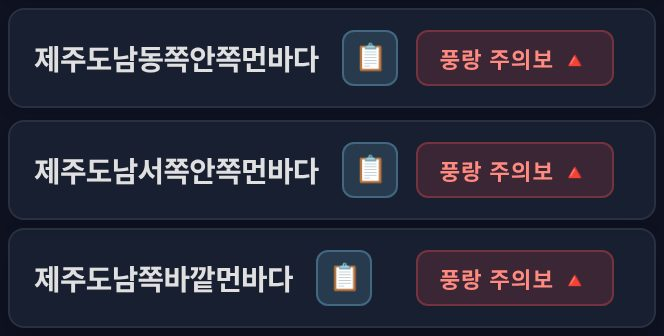
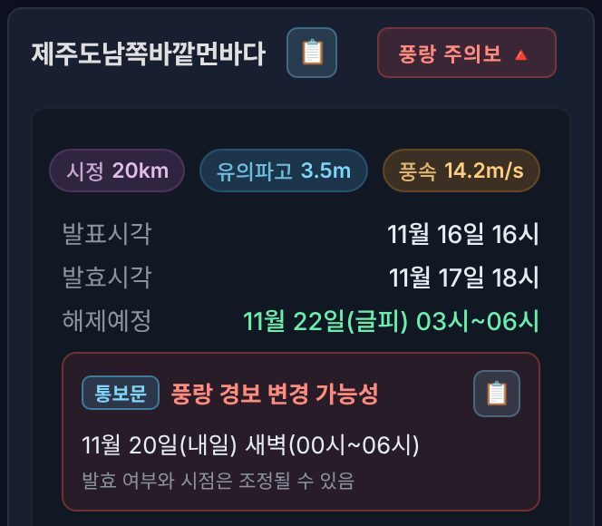
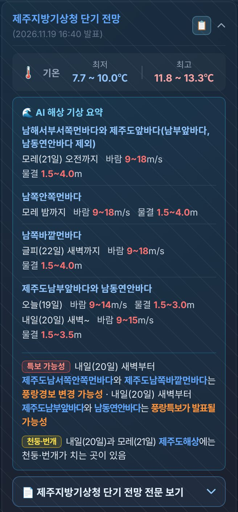
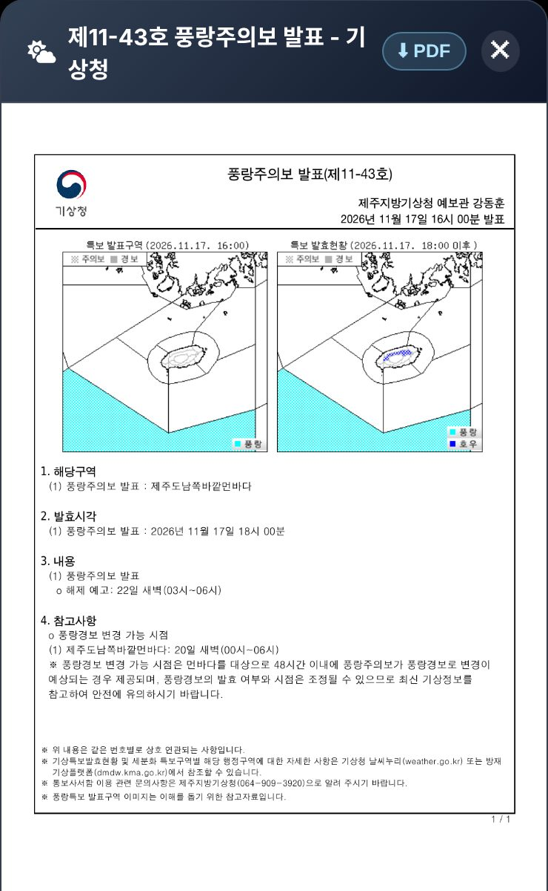

<!-- 패치노트 원본(작성 규칙: 저장소 NOTICE.md). 게시판에 올릴 파일은 `node scripts/notice/build_notice.js` 로 만든 patchnote.upload.md.
     범위: main 커밋 2026-11-18 23:00 ~ 2026-11-19 21:54 KST(비머지 42건) 중 사용자 체감분 — 항목은 사장님과 대화로 확정(2026-11-19).
     스크린샷: 2026-11-19 22시대 KST 운영 앱(390px 폭·2배, 방문·설문·POST 는 route 로 막음). 4번은 관심 기상청 = 제주지방기상청으로 두고 찍음.
     근거:
       1 격상 가능성 = 41fec16ef(🔺 뱃지·빨강 상자·출처 뱃지·📋) · 9b2f81741/55f88b625(검토 반영) — 화면 문구 「풍랑 경보 변경 가능성」·「발효 여부와 시점은 조정될 수 있음」(운영 화면 확인)
       2 AI 해상 기상 요약 = c777c07f6 · ba2640bc1(해제 예고) · 613e92917(「AI 해상 기상 요약」 제목 · 못 만들면 상자 없음 · 「… 단기 전망 전문 보기」 접기)
       3 통보문 원문 = be6ff84f7(우리 서버 보관·그림) · 3f43c9fbf(「⬇ PDF」 — ui_modal openKmaIframeModal opt.download)
       4 PC 빈 화면 = be6ff84f7(바깥 문서 뷰어를 거치지 않음 — 종전 0f66e74a7 은 원인 못 잡고 우회만)
       5 뒤로가기 = 58f58ca3a · 6 해양안전 해구기상 격자 = 10a547bd2 · 7 위험예측 해상 시트 = 90fe67e56 · 8 AI 챗봇 = 8dcc9ff37 · 9 조석 = e9787a0c7 -->
# 기능 추가·버그 수정 안내('26. 11. 18. ~ 19.)

새로 생긴 기능과 고친 문제를 알려드려요.

## ✨ 기능 추가

### 1. 경보·태풍 격상 가능성 표시

- 통보문이나 기상청 날씨해설에 ==「풍랑경보·태풍특보로 바뀔 가능성」==이 적혀 있으면 알려 드려요.
- 해당 특보구역 뱃지에 🔺 표시가 붙어요.

- 카드를 누르면 언제쯤인지와 근거가 된 통보문을 볼 수 있어요.
  - 📋 버튼을 누르면 근거 원문이 열려요.

- !!발효 여부와 시점은 바뀔 수 있으니!! 최신 특보를 함께 확인해 주세요.

### 2. 「AI 해상 기상 요약」

- [특보정보] 탭 「기상청 해상 기상 전망」의 지방청 단기 전망에서 바다 내용만 짧게 요약해 드려요.
- 해역별 바람·물결, 특보 가능성, 해제 예고 등을 한눈에 볼 수 있어요.

- 긴 전문은 접어 두고, ==「전문 보기」==를 누르면 펼쳐져요.
- 요약을 만들지 못한 때는 상자 없이 전문이 바로 보여요.

### 3. 통보문 원문 바로 보기 · PDF 받기

- 해역 카드의 📋 버튼 → 통보문을 누르면 원문이 창으로 바로 열려요.
- 창 위쪽 ==「⬇ PDF」== 버튼으로 휴대폰에서도 원문을 받을 수 있어요.

## 🔧 버그 수정

### 4. PC에서 통보문 원문이 빈 화면으로 뜨던 문제

- 원문을 우리 서버에서 바로 보여 주도록 바꿔서 근본적으로 해결했어요.

### 5. 통보문 창이 휴대폰 뒤로가기로 안 닫히던 문제

- 이제 휴대폰 뒤로가기 버튼으로 창이 닫혀요.

### 6. 해양안전 지도에 해구기상 격자가 남던 문제

- 해구기상을 꺼 놨는데도 [해양안전생활] 탭 지도에 격자가 남던 문제를 고쳤어요.

### 7. 위험예측 해상 시트 오류

- 매일 03:00~03:10, 15:00~15:10에 「위험 예측」 칸이 「-」로 비던 문제를 고쳤어요.
- 브리핑 카드에서 누른 해역 이름과 시트 제목이 다르던 문제도 고쳤어요.

### 8. AI 챗봇 알림 안내가 웹에서 뜨던 문제

- PC·모바일 웹에서는 푸시를 받을 수 없어 「완료되면 알림 드릴까요?」 안내를 띄우지 않아요.

### 9. 밤 시간 조석정보 조회 오류 추가 예방

- 서버가 다시 시작될 때 조석 자료를 오늘·내일 치만 받도록 줄였어요.
- 밤에 일부 조석 조회가 실패하던 일이 덜 생겨요.

## 💬 마무리

이번 업데이트도 이용해 주셔서 감사해요.

바다에서 더 안전하게 활동하실 수 있도록 정확하고 빠른 정보를 위해 계속 노력할게요.

불편한 점이나 오류는 화면 위쪽 ✉ 버튼(오류 제보)으로 언제든 알려 주세요.
