<!-- 패치노트 원본(작성 규칙: 저장소 NOTICE.md). 게시판에 올릴 파일은 `node scripts/notice/build_notice.js` 로 만든 patchnote.upload.md.
     범위: 앱 1.3.0(versionCode 17) 스토어 업데이트 — 2026-11-19~20 커밋(8f313efd 헤드업·앱 안 업데이트 · 31af2dcb 음성 비서 삭제 · 419f922d 아이콘 ·
       10ebe69e GPS 필수 해제 · 3433491f 백그라운드 위치 권한 제거 · b27ece21 업데이트 안내 창). 운영 문서 00_docs/operations/app-release-headsup-inapp-update.md.
     문구는 사장님과 대화로 확정(2026-11-20): 용량 절반 감소 · 검토 완료·전체 배포됨(사장님 확인) · 아이콘 「신호·파도 그대로, 더 예쁘게」 ·
       기존(1.1.1) 사용자는 이번 한 번만 스토어 · 신규는 1.3.0 으로 시작 · 「카톡처럼」 · 설정 경로 「바다:그 날」 · 「잠긴 상태에서 알림 내용 표시」 →
       「기본(항상 표시)」 · 메뉴 이름이 기기마다 다를 수 있음 · 업데이트가 안 되면 삭제 후 다시 설치.
     사진: 1 업데이트 안내 창(앱 화면 캡처 — 카드 둘레 사방 10px 로 고르게 자름) · 2 알림 예시(알약 둘레 사방 14px) · 3~5 휴대폰 설정 화면 — 모두 사장님이 준 캡처. 3·4·5 빨간 점선 강조는 PIL 로 그림.
     6_store_00~08: 사장님이 준 Play 스토어 소개 이미지 9장(zip) — 00(「첫번쨰 반영」)은 맨 위 소개 문장 아래, 01~08 은 「기타사항」에 번호 순서. 그림은 자르지 않고 크기만 줄임(720·540px). 소개 영상 링크는 사장님이 편집기에서 넣는다.
     ⚠앱 안 업데이트는 1.3.0 다음 버전에서 처음 실제로 확인된다(운영 문서 §4 ⑤ — 아직). -->
# 앱 1.3.0 업데이트 안내

SEA:GNAL 앱이 새 버전(1.3.0)으로 업데이트됐어요.

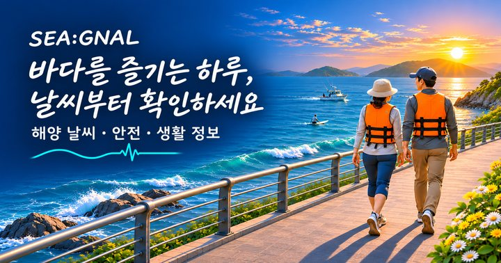

- **이미 설치하신 분(1.1.1 버전)**: 이번 한 번만 Play 스토어에서 업데이트해 주세요.
- **새로 설치하시는 분**: 처음부터 1.3.0 버전으로 시작돼요.

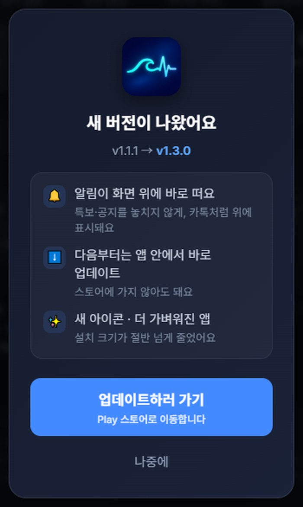

- !!업데이트가 되지 않으면!! 번거로우시더라도 앱을 삭제한 뒤 Play 스토어에서 다시 설치해 주세요.

## ✨ 새로워진 점

### 1. 앱 아이콘이 더 예뻐졌어요

- 익숙한 **신호와 파도 모양은 그대로** 두고, 더 깔끔하고 예쁘게 다듬었어요.

### 2. 알림이 화면 위에 바로 떠요

- 특보 같은 푸시 알림이 ==카톡처럼 화면 위에== 잠깐 떠서 바로 확인할 수 있어요.

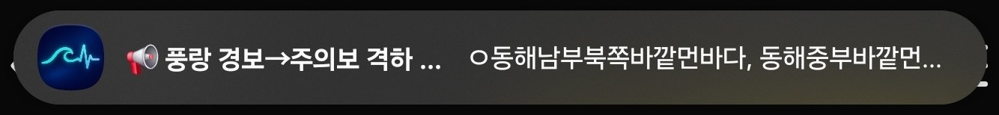

- 앱을 꺼 둔 상태에서도 똑같이 떠요.
- 화면이 잠겨 있을 때는 잠금화면에 알림으로 보여요.

### 3. 다음부터는 앱 안에서 바로 업데이트

- **이번 1.3.0부터**, 다음 업데이트는 Play 스토어에 가지 않아도 앱 안에서 바로 할 수 있어요.
  - 기존 사용자: 이번에 1.3.0으로 한 번만 업데이트하면, 그다음부터는 앱 안에서 돼요.
  - 신규 사용자: 1.3.0으로 시작하니, 처음부터 스토어 방문 없이 앱 안에서 돼요.
- 새 버전이 나오면 앱 안에 업데이트 안내가 떠요.
- 앱을 쓰는 동안 뒤에서 내려받고, 다 받으면 화면 아래 ==[다시 시작]== 버튼만 누르면 돼요.

### 4. 앱 용량이 절반으로 줄었어요

- 쓰지 않는 기능을 정리해서 **앱 용량이 절반으로 줄었어요.**
- 마이크 권한과 백그라운드 위치 권한을 더 이상 요청하지 않아요.

### 5. 태블릿에서도 업데이트할 수 있어요

- 일부 태블릿·크롬북에서 앱을 받거나 업데이트할 수 없던 문제를 고쳤어요.

## 💡 알림이 안 보일 때

### 화면 위에 알림이 뜨지 않으면

- ① 휴대폰 **설정 → 애플리케이션**으로 들어가요.
- ② ==「바다:그 날」==을 검색해서 누르고, **알림**으로 들어가요.

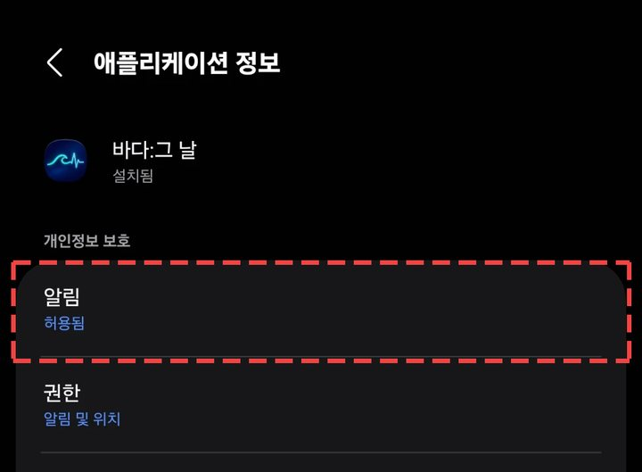

- ③ ==「알림 허용」== 토글을 켜 주세요.

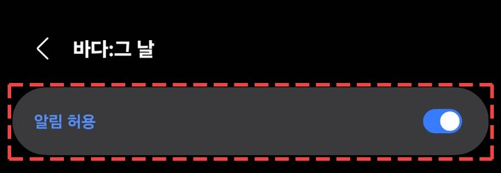

### 잠금화면에 알림이 보이지 않으면

- 같은 알림 화면에서 **「잠긴 상태에서 알림 내용 표시」**를 ==「기본(항상 표시)」==로 바꿔 주세요.

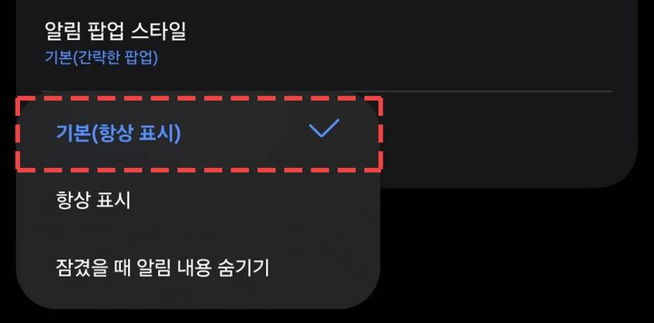

- 방해 금지 모드에서는 알림이 화면 위에 뜨지 않아요.

> 휴대폰 제조사나 안드로이드 버전에 따라 메뉴 이름이 조금 다를 수 있어요(예: 「애플리케이션」 대신 「앱」).

## 📌 기타사항

### Play 스토어 소개 이미지·영상이 새로워졌어요

- Play 스토어의 앱 소개 이미지와 소개 영상을 새로 바꿨어요.
- 앱의 주요 기능을 한눈에 보실 수 있어요.

▶ 소개 영상: (여기에 영상 링크를 넣어 주세요)

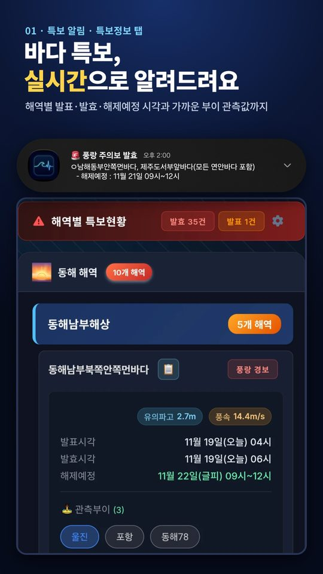

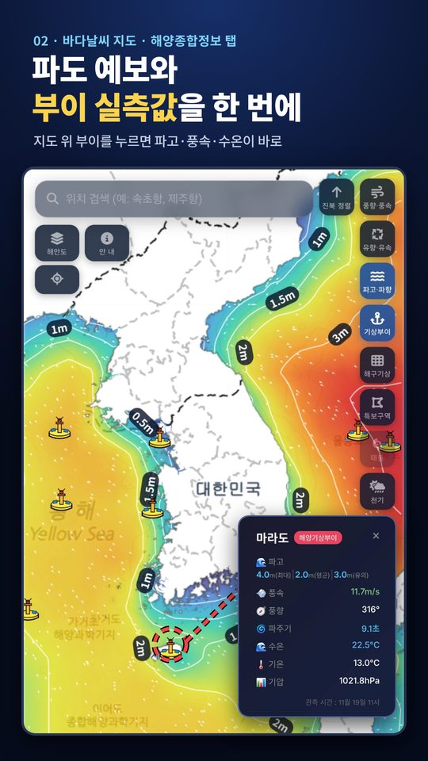

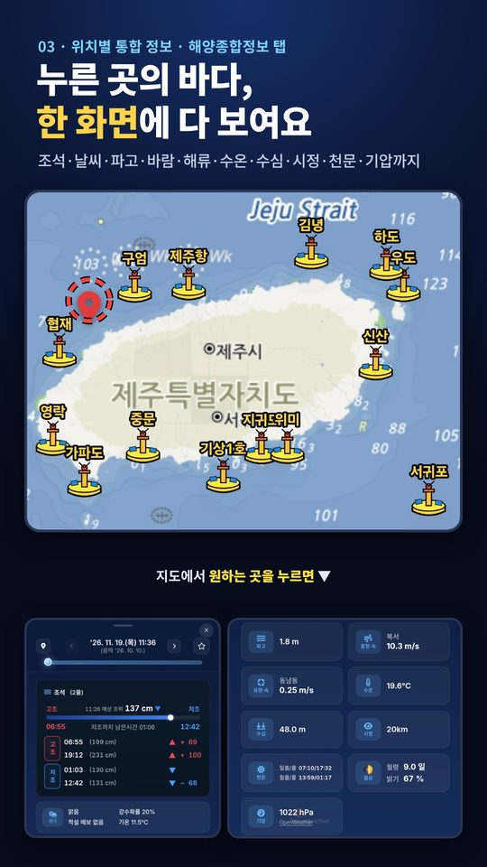

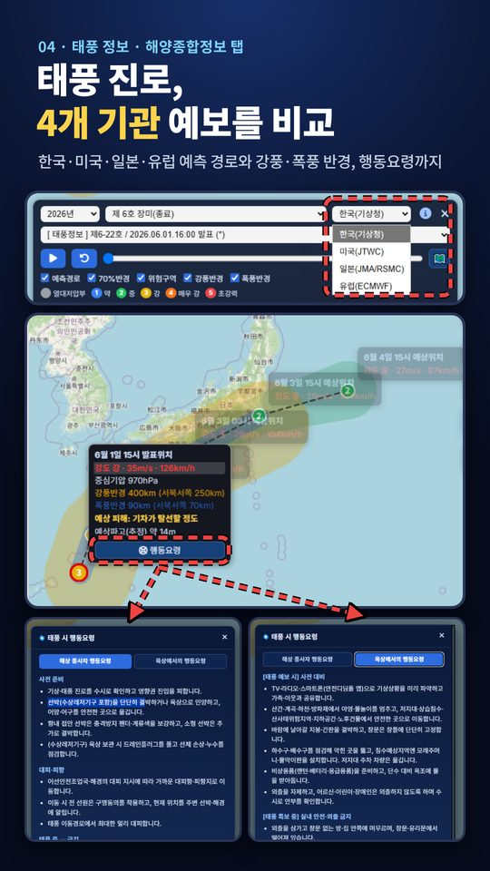

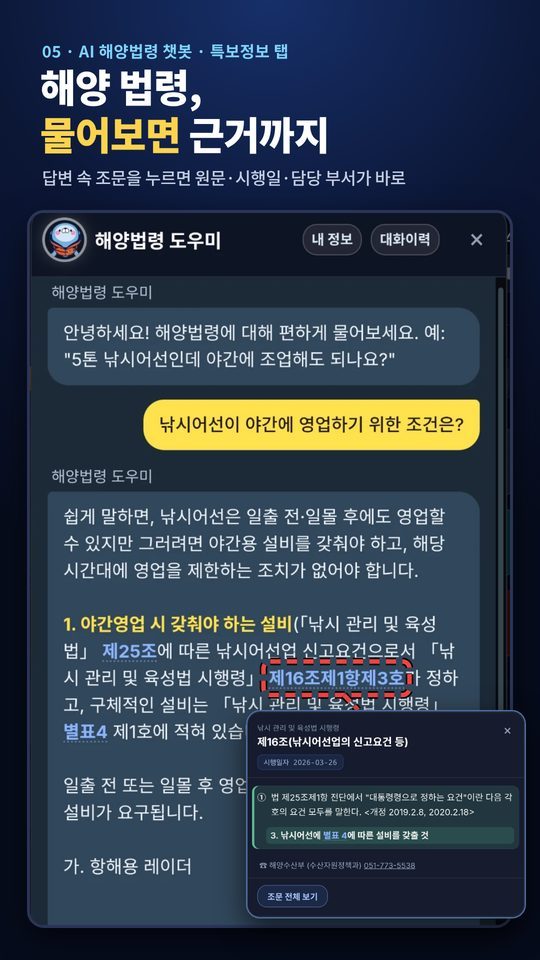

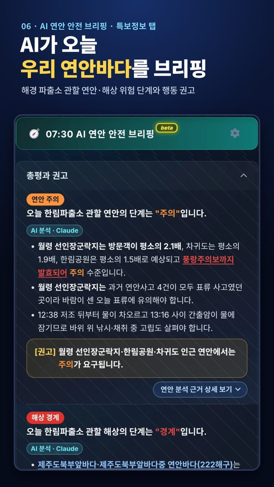

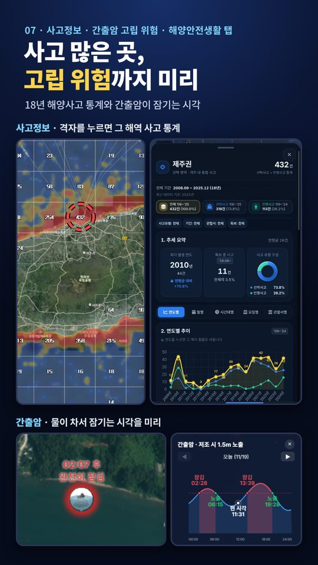

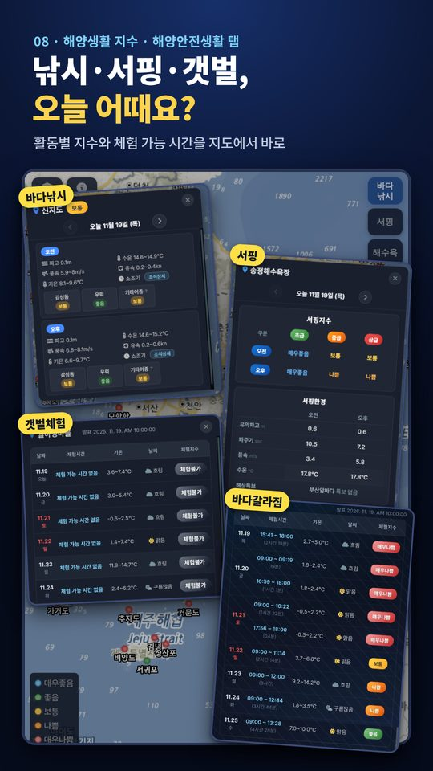

## 💬 마무리

이번 업데이트도 이용해 주셔서 감사해요.

바다에서 더 안전하게 활동하실 수 있도록 계속 노력할게요.

불편한 점이나 오류는 화면 위쪽 ✉ 버튼(오류 제보)으로 알려 주세요.
