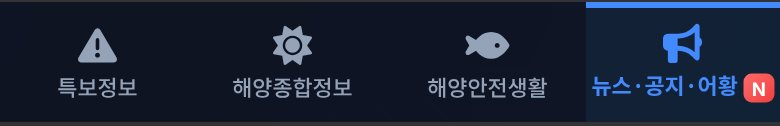
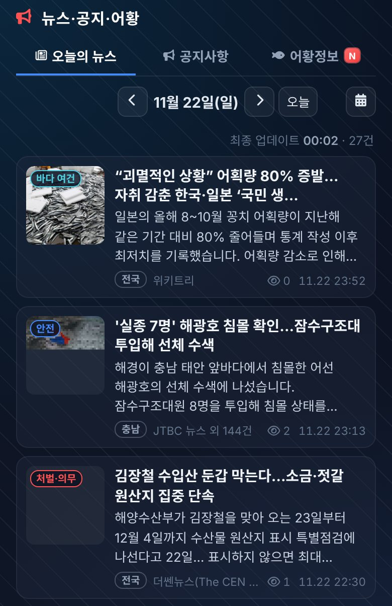
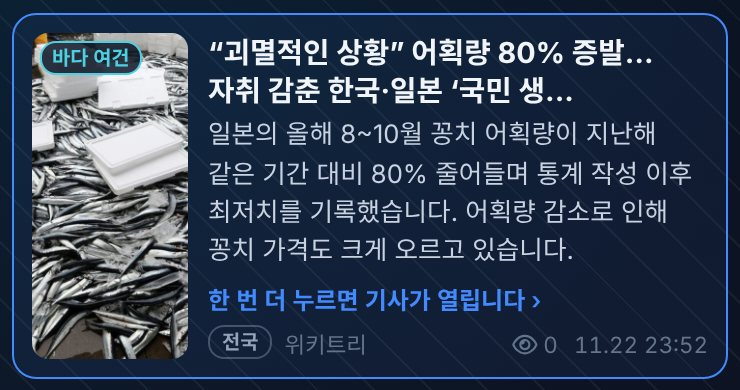
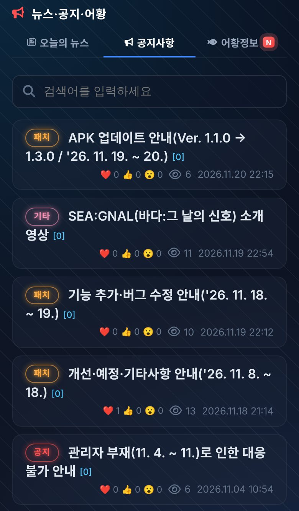
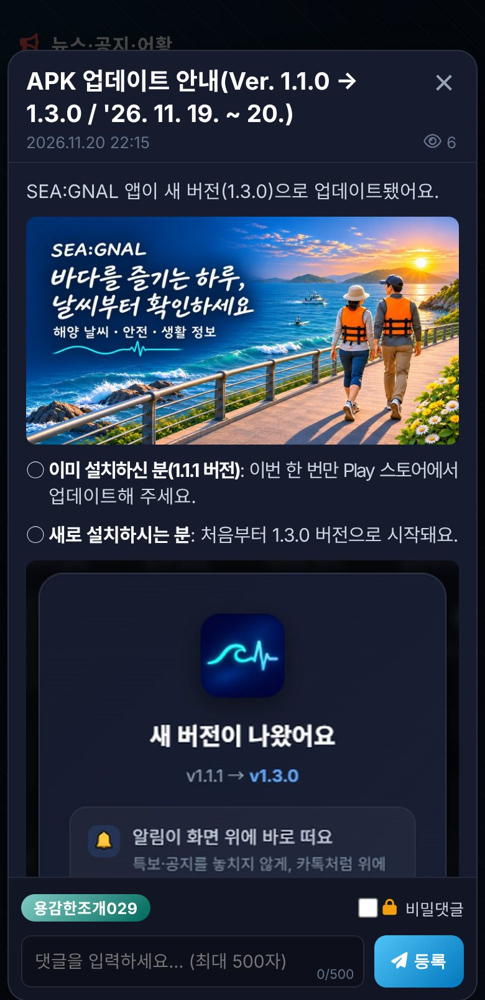
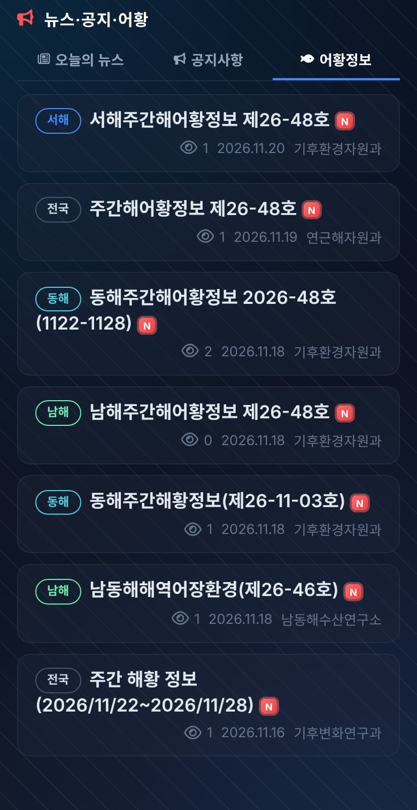
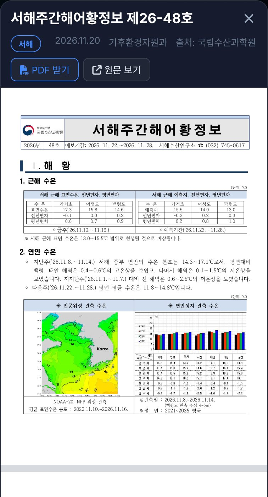

<!-- 패치노트 원본(작성 규칙: 저장소 NOTICE.md). 게시판에 올릴 파일은 `node scripts/notice/build_notice.js` 로 만든 patchnote.upload.md.
     범위: 「공지사항」 탭 → 「뉴스·공지·어황」 탭(2026-11-19~22 커밋 약 30건 — da321c02 앱 화면 · f41d1f96 뉴스 수집기 · 12f80d49 어황 수집기 ·
       645f6fb8 같은 사건 합치기 · 4b398859 당겨서 새로고침·다 봤어요·쪽 번호 · e77ca891/a853b1b6 위쪽 고정 · cffc6d56 공지 게시글 창 새 모양).
     문구: 이 세션 초안 → 사장님이 다른 세션에서 검토해 고친 판(2026-11-23). 고친 판의 새 문장은 코드로 대조함:
       「어떤 뉴스를 고르나요?」 = local_server/services/news_judge.js prompt([대상자]·「반드시 1점」 목록·해외 소식·같은 사건 new_info) + 마트 할인 기계 걸러냄(f41d1f96) ·
       지역(시·도) 꼬리표 = news.js .news-reg / news_judge REGIONS · 어황 바다 꼬리표 = fishcond_collector seaOf(서해·남해·동해·전국) · 보관 30일(두 수집기).
     스크린샷: 2026-11-23 00시대 KST 운영 앱(390px·2배, 방문·설문·POST 막음). 조회 수를 올리지 않게 — 공지 상세는 /api/promo 목록에서 꺼내 주고,
       어황 보기 페이지는 같은 모양을 쪽 그림으로 직접 만들어 줌(routes/fishcond.js 와 같은 HTML). 뉴스 펼친 횟수(POST)는 막힘.
       오늘(11-23)은 아직 기사가 없어 [어제 뉴스 보기]로 11-22 뉴스를 찍음. 어황은 글이 7건이라 쪽 번호 버튼이 안 나와 그 사진은 없음. -->
# 「뉴스·공지·어황」 탭 새 단장 안내

아래쪽 「공지사항」 탭이 ==「뉴스·공지·어황」== 탭으로 새로워졌어요.

- 탭 안에서 **오늘의 뉴스 · 공지사항 · 어황정보**를 골라 볼 수 있어요.

## 📰 1. 오늘의 뉴스 (새 기능)

### 무엇이 생겼나요?

- 바다에서 일하고 활동하는 분들께 필요한 뉴스만 AI가 골라 **매시간** 모아 드려요.
- 뉴스마다 **돈 · 처벌·의무 · 조업·이용 규칙 · 안전 · 바다 여건 · 갈등·제도** 꼬리표와 **지역(시·도)** 꼬리표가 붙어요.
- 같은 사건을 다룬 기사는 한 장으로 묶어 보여 드려요(「외 N건」).

### 어떤 뉴스를 고르나요?

- 어업인·양식인·낚시·레저 이용자를 중심으로, 돈·처벌·조업·안전에 실제 변화가 있는 기사만 실어요.
- 임명·취임, MOU·협약, 행사·축제·시상식, 단순 홍보·실적 자랑, 관광 개발, 마트 할인 기사는 싣지 않아요.
- 사고 기사는 새 소식이 있을 때만 다시 올려요.
- 해외 소식은 우리 선원·선박이나 국내 규칙과 관련 있을 때만 실어요.

### 어떻게 보나요?

- 뉴스를 누르면 요약이 펼쳐지고, ==한 번 더 누르면 원문 기사==로 이동해요.

- !!요약은 AI가 만들어요.!! 정확한 내용은 원문으로 확인해 주세요.
- 날짜 줄의 ◀ ▶ 버튼이나 달력으로 **최근 30일** 뉴스를 볼 수 있어요.

## 📢 2. 공지사항 (새 단장)

- 목록 줄 끝에 반응·조회 수·날짜가 깔끔하게 정리됐어요.

- 게시글 창이 새로워졌어요.
  - 화면을 꽉 채워 글이 더 크게 보여요.
  - 아래로 내려도 제목은 위에 고정돼요.
  - 댓글 입력칸이 아래에 고정돼 언제든 바로 쓸 수 있어요.
  - ❤️ 👍 😮 반응 버튼이 글 끝으로 옮겨졌어요.

## 🐟 3. 어황정보 (새 기능)

### 무엇이 생겼나요?

- **국립수산과학원 어황정보**(주간 해어황 등)를 매시간 확인해 새 글을 가져와요(최근 한 달 치 보관).
- 글마다 바다 꼬리표(동해·서해·남해·전국)가 붙어 있어요.

### 어떻게 보나요?

- 글을 누르면 원문이 그림으로 바로 열려요. ==PDF 받기==와 ==원문 보기==도 할 수 있어요.

- 10건씩 보여 드리고, 아래 쪽 번호로 넘겨 볼 수 있어요.

## ✨ 함께 좋아진 점

- **당겨서 새로고침**: 목록 맨 위에서 아래로 당겼다 놓으면 최신 목록을 다시 불러와요.
- **위쪽 고정**: 아래로 내려도 맨 위 제목과 오늘의 뉴스·공지사항·어황정보 버튼이 고정돼요.
  - 오늘의 뉴스는 날짜 줄도 함께 고정돼요.
- 새 글이 있으면 칸과 아래쪽 탭에 ==N== 표시가 붙어요.
- 탭을 처음 열면, 24시간 안에 새 공지가 있으면 공지사항이, 없으면 오늘의 뉴스가 먼저 보여요.

## 💬 마무리

이번 업데이트도 이용해 주셔서 감사해요.

바다에서 더 안전하게 활동하실 수 있도록 계속 노력할게요.

불편한 점이나 오류는 「특보정보」 탭 맨 위 ✉ 버튼(오류 제보)으로 알려 주세요.
