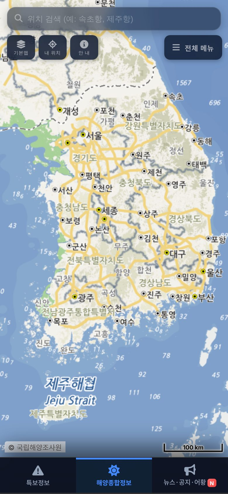
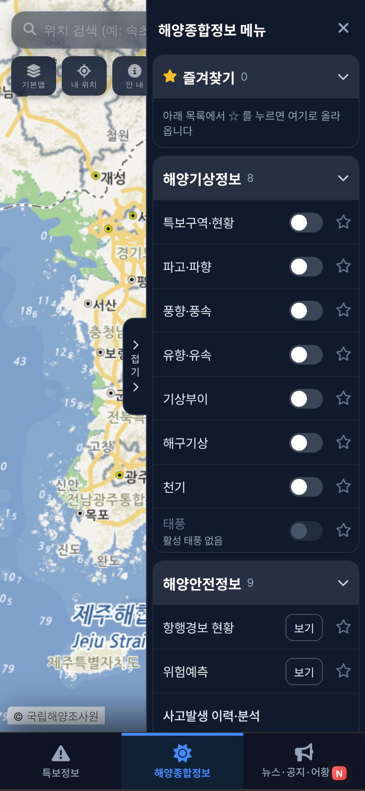
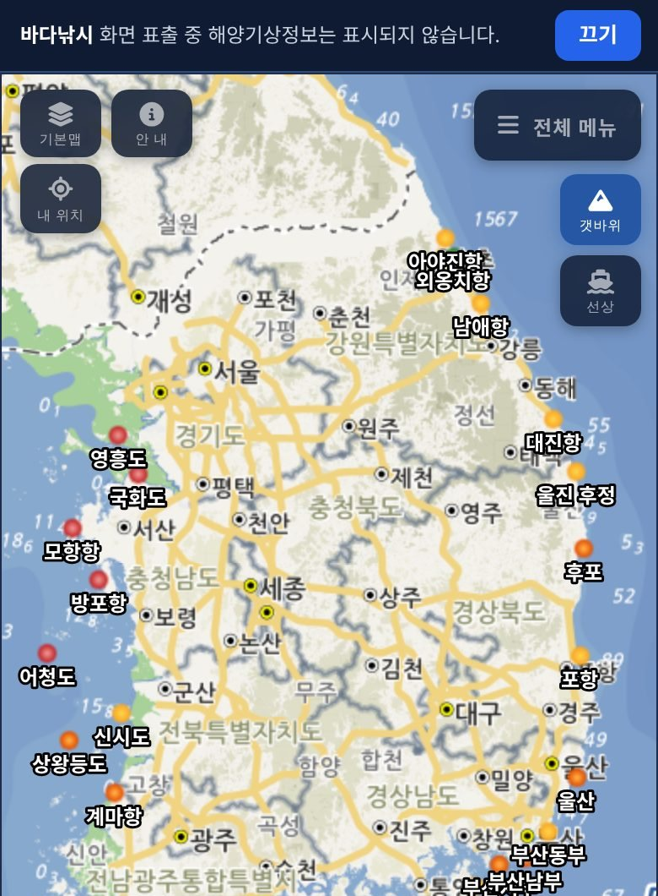
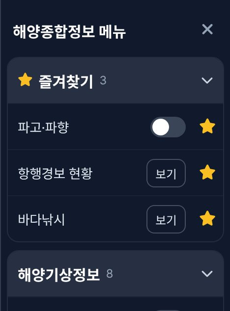

<!-- 패치노트 원본(작성 규칙: 저장소 NOTICE.md). 게시판에 올릴 파일은 `node scripts/notice/build_notice.js` 로 만든 patchnote.upload.md.
     ⚠초안 — 올리지 않는다. 2026-11-23 현재 「새 모드」는 시험 화면이다(해양종합정보 탭 3초 안 10번 누름 · 앱을 끄면 원래대로 —
       client/js/ocean-map/menu/README.md). 사장님 지시: 「초안만 미리 … 올리는 건 기본 전환 뒤에」 · 「메인에 머지 되었다고 가정하고」.
       기본 전환 때 바뀌는 것이 있으면(이름·버튼·묶음) 이 글과 사진을 다시 맞춘다.
     범위: e78e935d(통합 사이드바) · 7dc1d7c4·05768e02(2·3차 조정) · 7af18693(진북 고정) 등 2026-11-23 새 모드 커밋 11건.
       사장님: 「변경된 ui, 사용방법, 기능이 변경된 부분, 즐겨찾기 활용 방법 등만」 · 「상세하게 모든 화면을 찍을 필요는 없을 것 같아」.
     근거(코드·README 확인): 메뉴 4칸·이름 = ocean_menu.js FOLDERS/SWITCHES/VIEWS · 하나만 켜지는 묶음(특보구역·현황/파고·파향/풍향·풍속/유향·유속/천기) ·
       함께 켤 수 있음(기상부이·해구기상·태풍·CCTV) · 배경 우선순위(_arbitrateBasemap) · 안내 줄 문구 · 닫는 법(✕·접기·바깥·뒤로가기) ·
       즐겨찾기 = ☆ · 휴대폰 localStorage 저장 · 새 모드에서 아래 탭 3개(해양안전생활 탭 숨김 — 운영 화면 확인) · 진북 고정(7af18693).
     스크린샷: 2026-11-23 15~16시 KST 운영 앱에서 탭 10번으로 새 모드를 켜고 찍음(390px·2배, 방문·설문·POST 막음, 첫 화면 공지 팝업은 찍을 때만 숨김).
       즐겨찾기 사진은 파고·파향·항행경보 현황·바다낚시 ☆ 를 누른 뒤(찍는 브라우저에만 저장 — 운영 자료 아님). -->
# 「해양종합정보」 탭 새 단장 안내

**해양종합정보**와 **해양안전생활** 탭이 하나로 합쳐졌어요.

- 아래쪽 탭은 **특보정보 · 해양종합정보 · 뉴스·공지·어황** 세 개가 됐어요.
- 해양안전·해양생활 기능은 모두 해양종합정보 탭 안에서 볼 수 있어요.

## 🗺️ 1. 바뀐 화면

- 지도 오른쪽에 세로로 늘어서 있던 버튼들이 ==「전체 메뉴」== 버튼 하나로 정리됐어요.
- 지도가 넓어져 바다를 더 시원하게 볼 수 있어요.

## 👆 2. 사용 방법

- 지도 오른쪽 위 ==「전체 메뉴」==를 누르면 오른쪽에 메뉴가 열려요.
- 메뉴는 네 칸으로 나뉘어 있어요.
  - **즐겨찾기**: 자주 쓰는 기능을 모아 둬요.
  - **해양기상정보**: 스위치로 켜고 꺼요(파고·풍향·유향·특보구역 등).
  - **해양안전정보**: [보기]로 열어요(항행경보·위험예측·사고·위험지형 등).
  - **해양생활지수**: [보기]로 열어요(바다낚시·서핑·스킨스쿠버 등).

- 메뉴는 ✕, 왼쪽 「접기」 손잡이, 지도 누르기, 휴대폰 뒤로가기로 닫을 수 있어요.

## 🔄 3. 달라진 기능

### [보기] 화면

- 해양안전정보·해양생활지수의 [보기]를 누르면 그 화면이 지도에 바로 열려요.
- 보는 동안 맨 위에 「○○ 화면 표출 중 해양기상정보는 표시되지 않습니다」 줄이 떠요.
- ==[끄기]==를 누르면 원래 지도로 돌아오고, 켜 두었던 기상정보가 그대로 다시 나와요.

### 해양기상정보

- 특보구역·현황 / 파고·파향 / 풍향·풍속 / 유향·유속 / 천기는 서로 겹쳐 보기 어려워 **한 번에 하나만** 켜져요.
- 기상부이·해구기상·태풍·CCTV는 함께 켤 수 있어요.
- 켠 정보에 맞춰 **배경지도가 알아서 바뀌어요**(태풍 → 세계지도, 해구기상 → 기본맵, 파고·풍향 등 → 해안도).
- 지도는 늘 북쪽이 위로 고정돼요(진북 정렬 버튼은 없앴어요).

## ⭐ 4. 즐겨찾기 활용하기

- 메뉴 각 줄 오른쪽의 ☆를 누르면 맨 위 ==「즐겨찾기」==에 모여요.
- 즐겨찾기에서도 바로 켜거나 [보기]로 열 수 있어요.

- ★를 한 번 더 누르면 즐겨찾기에서 빠져요.
- 즐겨찾기는 휴대폰에 저장돼서 앱을 다시 켜도 그대로 남아요.

## 💬 마무리

이번 업데이트도 이용해 주셔서 감사해요.

바다에서 더 안전하게 활동하실 수 있도록 계속 노력할게요.

불편한 점이나 오류는 「특보정보」 탭 맨 위 ✉ 버튼(오류 제보)으로 알려 주세요.
