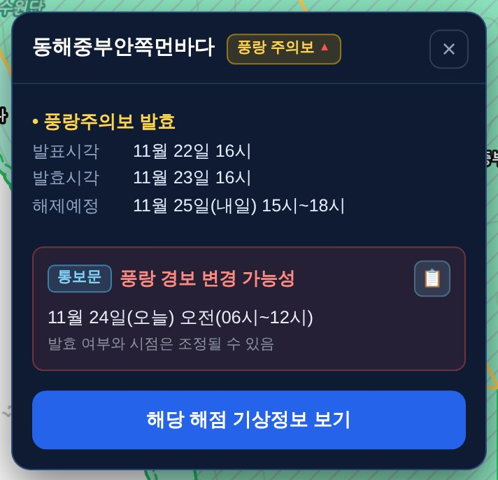
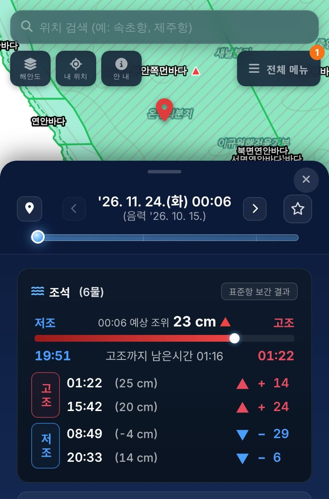
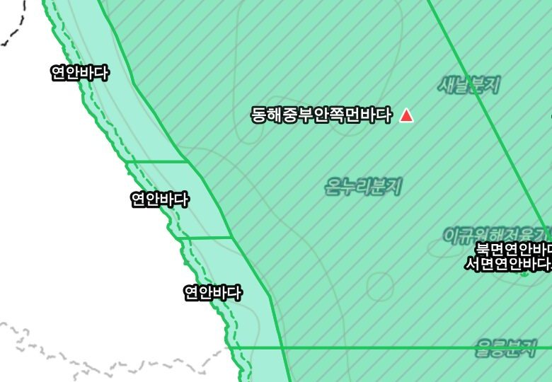

<!-- 패치노트 원본(작성 규칙: 저장소 NOTICE.md). 게시판에 올릴 파일은 `node scripts/notice/build_notice.js` 로 만든 patchnote.upload.md.
     범위: b0493f23 「특보구역·현황: 구역 이름 옆 격상·격하 세모 + 가운데 팝업 → [해당 해점 기상정보 보기]」 — PR #1582 로 2026-11-24 머지·배포(운영 판 WarnPop_20261123 확인).
     배경: 새 메뉴 화면이 2026-11-23 기본이 되면서(3774c3a1) 특보 해역을 누르면 특보 상자 대신 해점 바텀시트가 떴다(ocean_warn_active5 om-mode 분기) →
       사용자 기능 건의(앱 제보 「기능 건의」 2026-11-23 23:11 — 닉네임은 공지에 싣지 않음).
     근거(코드 확인): 팝업 = ocean_warn_active5.js _omDecorate(머리 구역 이름+뱃지 ▲▼ · 발효 중 「발표시각·발효시각·해제예정」 · 다가오는 특보 「발표·발효·해제예정」 ·
       경보·태풍 변경 가능성 상자(경보가 이미 발표됐으면 없음) · [해당 해점 기상정보 보기] → 바텀시트, 지점은 시트에 안 가리게 위로) ·
       특보 없는 해역은 바로 바텀시트 · 뒤로가기로 닫힘(PopupStack) · ▲ 「높은 단계로 올라갈 수 있음」 ▼ 「낮은 단계로 내려갈 예정」(aria-label) ·
       시트가 열리면 범례가 시트 뒤로.
     스크린샷: 2026-11-24 00시대 KST 운영 앱(390px·2배, 방문·설문·POST 막음, 첫 화면 공지 팝업은 찍을 때만 숨김) — 동해중부안쪽먼바다(그때 경보 변경 가능성 안내가 있던 해역).
       ⚠초록 ▼(격하)는 그때 자료에 사례가 없어 사진이 없다. -->
# 사용자 기능 개선 요구 반영 안내

보내 주신 의견을 반영해 **해양종합정보의 특보구역 팝업**을 다시 넣었어요.

## 💬 어떤 건의가 있었나요?

> 「해양종합정보 → 특보구역·현황에서 지도의 특보구역을 누르면 해당 구역의 특보 발표·발효·해제 시간을 볼 수 있어 좋았는데, 업데이트 이후 조석이나 일몰·일출 같은 해양정보만 보이게 바뀌었네요. 예전처럼 특보구역 정보를 보여 주는 팝업이 떴으면 좋겠습니다.」

- 해양종합정보 화면이 새로워지면서, 특보 해역을 눌러도 특보 정보 대신 해양정보 창만 열리게 바뀌어 있었어요.

## 🔧 어떻게 바꿨나요?

### 특보 해역을 누르면 팝업이 먼저 떠요

- 특보가 있는 해역을 누르면 그 지점이 화면 가운데로 옮겨진 뒤 ==특보 팝업==이 떠요.
- 팝업에서 볼 수 있는 것
  - 구역 이름과 특보 뱃지
  - 발효 중인 특보: 발표시각 · 발효시각 · 해제예정
  - 다가오는 특보: 발표 · 발효 · 해제예정
  - 경보·태풍으로 바뀔 가능성이 있으면 그 안내(📋로 근거 원문 보기)

### 해양정보는 버튼 하나로

- 팝업 맨 아래 ==[해당 해점 기상정보 보기]==를 누르면 그 지점의 조석·날씨 등 해양정보 창이 열려요.
- 누른 지점이 창에 가리지 않게 지도가 위로 살짝 옮겨져요.

- 특보가 없는 해역은 지금처럼 누르면 바로 해양정보 창이 열려요.
- 팝업은 ✕나 휴대폰 뒤로가기로 닫을 수 있어요.

## ✨ 함께 좋아진 점

- 지도의 구역 이름 옆에 화살표가 붙어요.
  - ==빨간 ▲==: 더 높은 특보(경보·태풍)로 올라갈 수 있어요.
  - ==초록 ▼==: 낮은 단계로 내려갈 예정이에요.

- 해양정보 창이 열리면 특보 범례가 창 뒤로 숨어서 내용을 가리지 않아요.

## 💬 마무리

소중한 의견을 보내 주셔서 감사해요.

앞으로도 불편한 점이나 바라는 기능이 있으면 「특보정보」 탭 맨 위 ✉ 버튼으로 언제든 알려 주세요.
