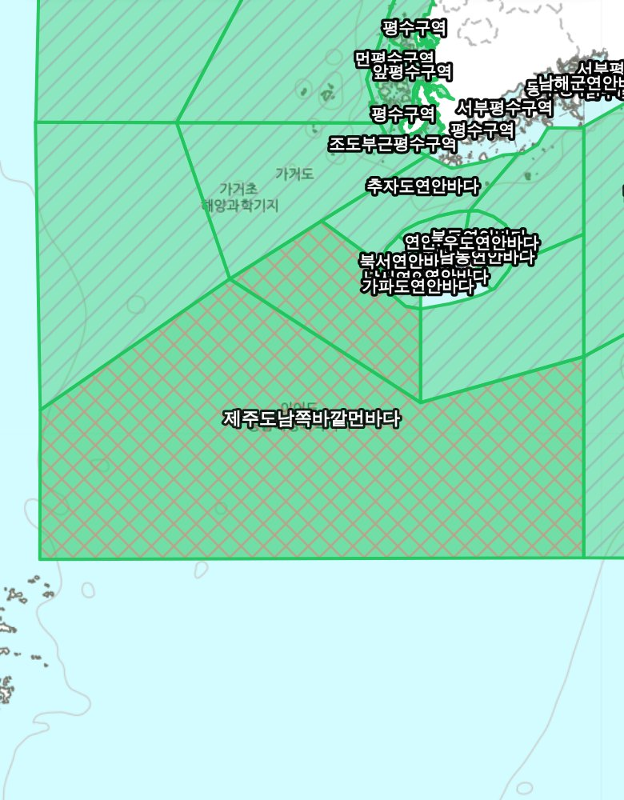
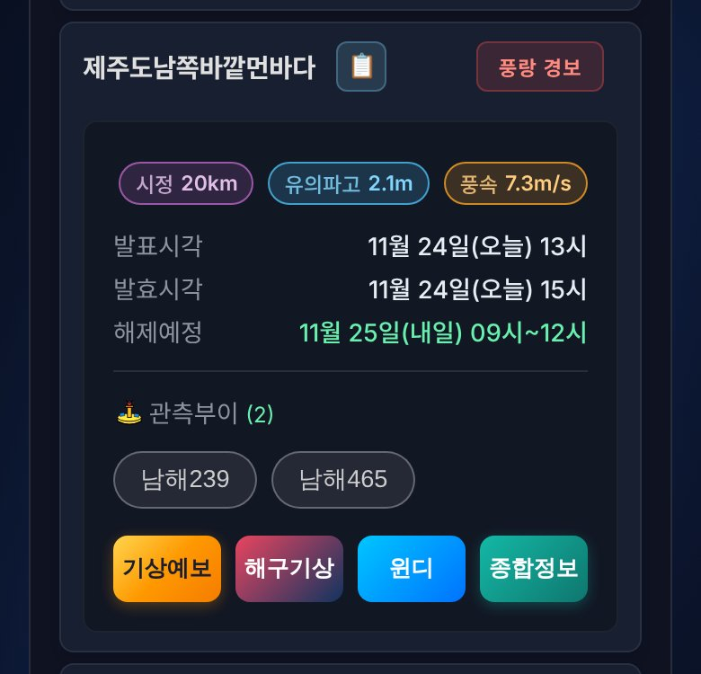
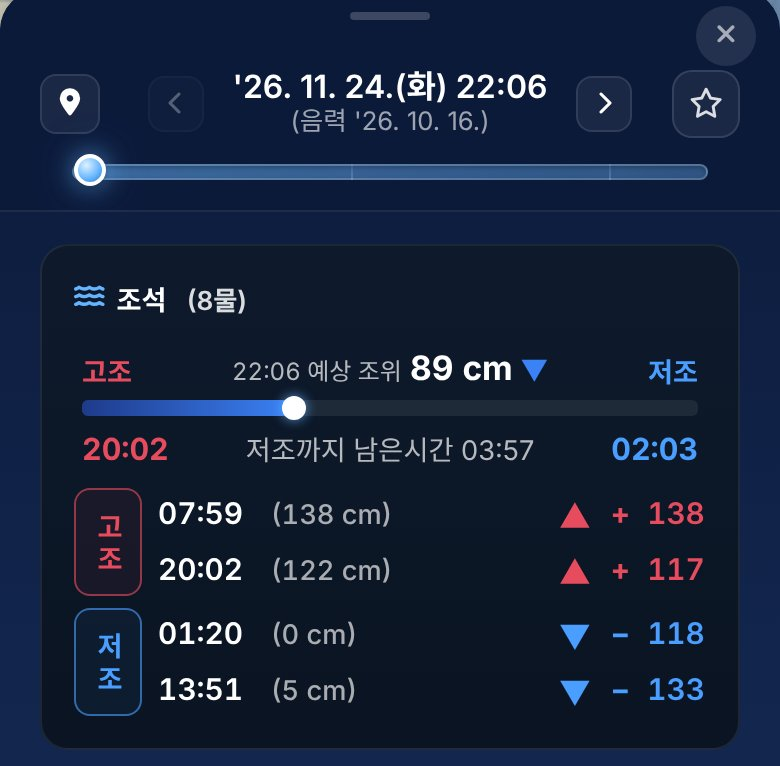
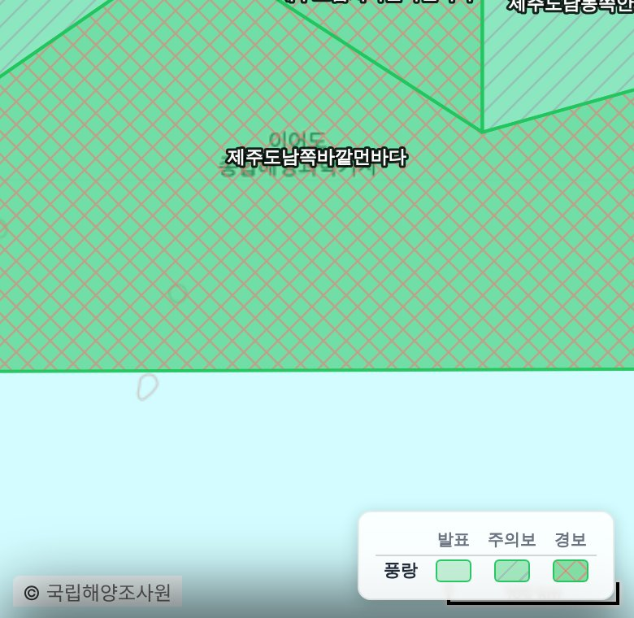

<!-- 패치노트 원본(작성 규칙: 저장소 NOTICE.md). 게시판에 올릴 파일은 `node scripts/notice/build_notice.js` 로 만든 patchnote.upload.md.
     범위: 구역 분할 PR #1586(2026-11-24 14:57 머지 — 09b9870a·f361fd41·…·31f5c022 MMIS 감지 전환·e29e815e·9fa10706) +
       그 뒤 버그 수정 PR #1587(32cecad6 특보 색칠 · 6b718462/ad202d62/c2926749/cf56c9ae 물때·조석·탭 왕복) · PR #1589(420ec6ab 경보 ✕ 빗금).
     문구는 사장님과 대화로 확정(2026-11-24): 25일에라도 기상청 특보가 두 구역으로 나뉘어 나오면 그때 반영 · 부재 「내일부터 12월 5일까지」 =
       11월 25일(수)~12월 5일(토) — 2026-11-23 이 월요일(앱 화면 날짜줄)이라 12-05 는 토요일.
     근거(코드·설계 확인): client/js/core/zone_split.design.md §1(경계 동경 126°17′40″ · 남서쪽 더 큼 · 44→45) · §2-1(MMIS·푸시 열기 · 구독 이어받기) ·
       §3 전환 조건(① MMIS 새 코드 보는 즉시 ② 2026-11-25 00:00 KST 뒤 옛 구역 특보 없음 10주기) · 켜 둔 화면 5분마다 한 번 새로고침 ·
       회색 버튼 4개 문구 MSG_BUTTON · 「-」 문구 MSG_VALUE(zone_avg.js) · 부이 버튼 활성 · §5 한계(전환 순간이 처음).
     사진 4장(2026-11-24 22시 KST, 운영 앱 https://seagnal-server.fly.dev/ 를 390×844 로 열어 요소 위치로 자름 · 방문·설문·사용 기록 전송은 막음):
       1_zone_now(해양종합정보 지도 — 지금의 한 구역. 그때 실제로 풍랑경보 발효 중이라 ✕ 빗금) · 2_warn_cross(같은 구역 확대 + 범례) ·
       3_alert_card(특보정보 탭 제주 해역의 그 구역 카드를 펼친 모습) · 4_tide(해양정보 창 조석 칸 — 음력 10.16. = 8물).
       나뉜 뒤(두 구역) 화면은 아직 전환 전이라 없다 — 꾸며 넣지 않고 「지금 화면」이라고 밝혀 넣었다.
       문구 수정: 「시정 · 평균 파고 · 평균 풍속」→ 카드에 실제로 적힌 이름 「시정 · 유의파고 · 풍속」(3_alert_card 로 확인). -->
# 제주도남쪽바깥먼바다 특보구역 분할 안내 및 관리자 부재 안내

기상청이 해상 특보구역 **「제주도남쪽바깥먼바다」를 두 구역으로 나눠요.** SEA:GNAL도 이에 맞춰 바뀌는 내용을 미리 알려드려요.

## 📌 1. 왜 바뀌나요? (배경)

- 기상청이 **11월 26일**부터 「제주도남쪽바깥먼바다」를 **동경 126°17′40″ 선**을 기준으로 둘로 나눠요.
  - **제주도남서쪽바깥먼바다**: 서쪽, 더 넓은 구역
  - **제주도남동쪽바깥먼바다**: 동쪽, 더 좁은 구역
- 바깥 경계는 그대로이고, 안쪽에 선 하나가 생기는 거예요.
- 해상 특보구역은 44개에서 45개가 돼요.

- 위 사진은 **지금 화면**이에요. 아래쪽 큰 구역 하나가 **좌우 두 구역**으로 나뉘어요.

## ⏰ 2. 언제, 어떻게 바뀌나요?

### 바뀌는 시점: 자동으로 넘어가요

- 앱을 따로 업데이트할 필요 없이, **서버가 알아서** 새 구역으로 바꿔요.
- 기상청 적용일은 **11월 26일**이지만, 그 전이라도 아래 경우에는 바로 바뀌어요.
  - ==25일에라도 기상청 특보가 두 구역으로 나뉘어 나오기 시작하면==, 그 순간 바로 반영돼요.
  - **11월 25일 0시 이후** 「제주도남쪽바깥먼바다」에 특보가 하나도 없는 때가 오면, 그때 미리 두 구역으로 바꿔 둬요.
- 특보가 발효 중일 때 억지로 바꾸면 정보가 꼬일 수 있어서, 안전한 순간을 기다렸다가 바꿔요.

### 바뀐 뒤에는

- 해양종합정보 지도의 특보구역 경계선이 **두 구역**으로 나뉘어 보여요.
- 특보정보 탭의 해역별 특보현황에도 **카드가 두 장**으로 나와요.
- 앱을 켜 둔 상태라면 **5분 안에 한 번 자동으로 새로고침**되면서 바뀐 화면이 보여요.

## 🔔 3. 푸시 알림은 이렇게 돼요

- **제주도남서쪽바깥먼바다**와 **제주도남동쪽바깥먼바다**도 다른 해역과 똑같이 특보 푸시 알림을 보내 드려요.
- 안쪽먼바다 등 주변 해역도 지금처럼 정상으로 보내요.
- ==기존 「제주도남쪽바깥먼바다」 알림을 받던 분==은 따로 설정하지 않아도 새 두 구역의 알림을 그대로 이어받아요.
- 기존 구역 알림을 꺼 두셨던 분은 새 두 구역도 꺼진 상태로 이어져요.

## 🚧 4. 당분간 쓸 수 없는 기능

새 두 구역 카드에서는 정확한 정보를 드리기 위한 추가 수정이 끝날 때까지 아래 기능을 잠시 멈춰요.

- 위 사진은 **지금 카드**예요. 새 두 구역 카드에서는 아래처럼 달라져요.

- **기상예보 · 해구기상 · 윈디 · 종합정보** 버튼은 **회색**으로 바뀌어요.
  - 누르면 「기상청 특보구역 변경에 따른 수정 진행 중입니다.」라고 안내해요.
- 맨 위 **시정 · 유의파고 · 풍속** 수치는 **「-」**로 보여요.
  - 누르면 「추후 제공될 예정입니다」라고 안내해요.
- **관측부이** 버튼(사진의 남해239 등)은 그대로 쓸 수 있어요.

## 🙏 5. 양해 부탁드려요

- 기상청의 구역 변경이 **아직 실제로 시작되지 않아서**, 새 구역 자료가 어떤 모양으로 들어오는지 미리 확인할 수 없었어요.
- !!그래서 두 구역의 푸시 알림, 지도 특보구역 표시, 특보 카드 표시가 한동안 정확하지 않을 수 있어요.!!
- 실제 변경 뒤 들어오는 자료를 확인해서 **정확한 정보를 드릴 수 있도록 고쳐 나갈게요.**
- 그동안은 **기상청 특보 원문**도 함께 확인해 주세요.

## 🔧 6. 버그 수정

### 앱을 다시 켜면 특보 색칠이 안 되던 문제

- 특보구역을 켜 둔 채 앱을 껐다 켜면, 구역 선만 보이고 특보 색칠은 꺼져 있었어요.
- 이제 앱을 다시 켜도 **색칠까지 그대로** 켜져 있어요.

### 해양정보 창의 물때·조석 표시 오류

- **물때**가 하루 사이에 12물에서 14물로 건너뛰거나, 같은 날인데도 바뀌던 문제를 고쳤어요.
  - 이제 **음력 날짜 기준**으로 정확하게 보여요.
- **조석 칸**이 여러 번 깜빡이거나 내용이 왔다 갔다 하던 문제를 고쳤어요.
- 창 높이가 여러 번 오르내리던 것도 **한 번만 부드럽게** 바뀌어요.

### 다른 탭에 다녀오면 켜 둔 기능이 꺼지던 문제

- 기상부이·특보구역 등을 켜 둔 채 특보정보 탭에 다녀오면 전부 꺼지던 문제를 고쳤어요.
- 이제 다른 탭에 다녀와도 **켜 둔 그대로** 유지돼요.

### 경보 구역 ✕ 빗금이 지도에 안 나오던 문제

- 범례에는 경보가 ✕ 빗금으로 나오는데, 지도에서는 한 방향 빗금으로만 보였어요.
- 이제 지도에서도 **경보 구역이 ✕ 빗금**으로 보여요.

## 📢 7. 관리자 부재 안내

- 운영자의 부득이한 사정으로 ==11월 25일(수)부터 12월 5일(토)까지== 앱 관리가 어려워요.
- !!이 기간에 오류가 생기거나 ✉ 제보·건의를 보내 주셔도 바로 반영하기 어려워요.!!
- 보내 주신 의견은 복귀한 뒤 하나씩 확인해서 조치할게요. 너그럽게 양해 부탁드려요.

## 💬 마무리

이번 업데이트도 이용해 주셔서 감사해요.

바다에서 더 안전하게 활동하실 수 있도록 계속 노력할게요.
