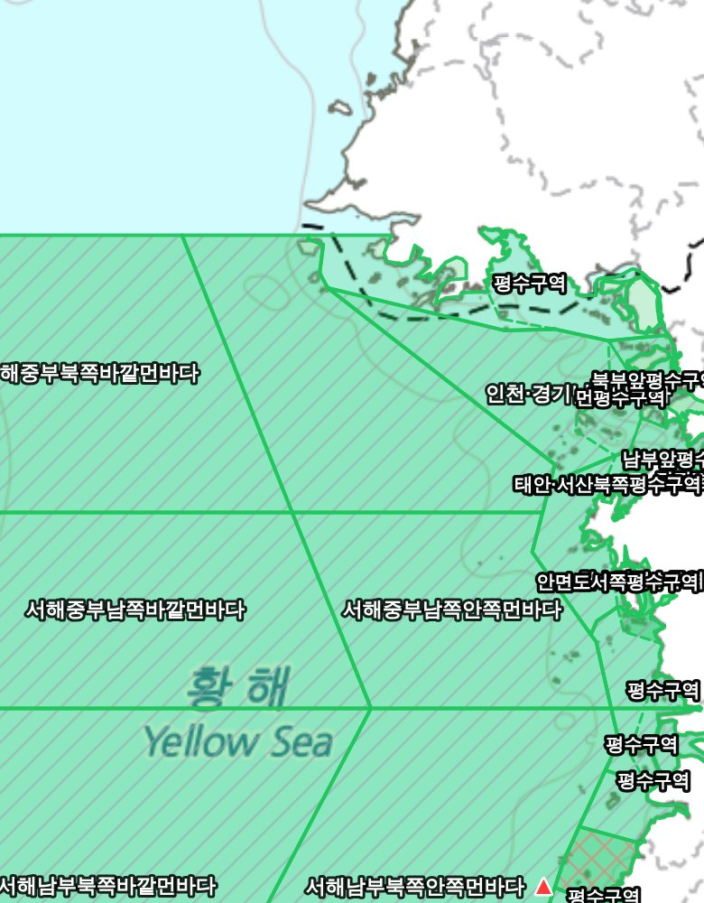
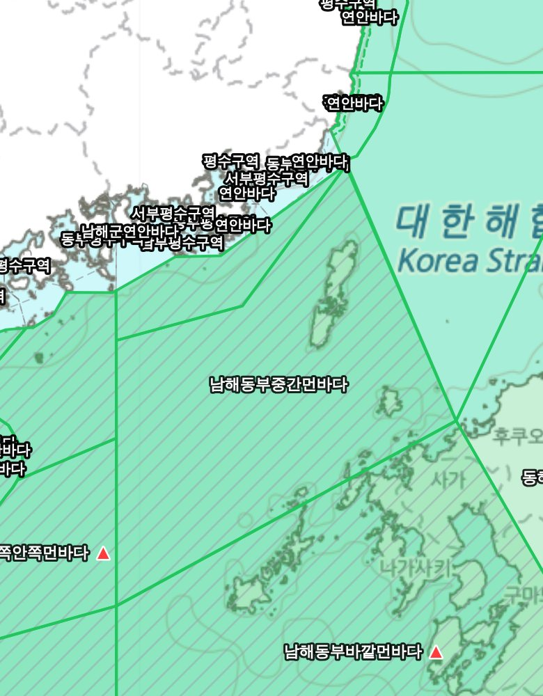
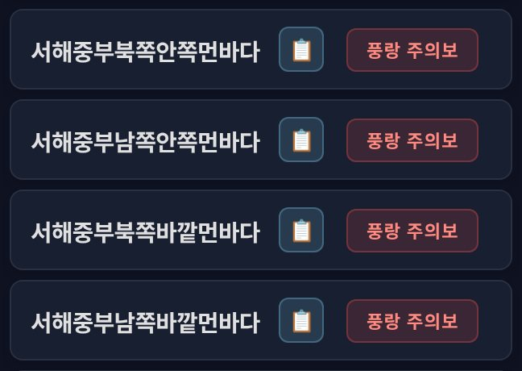
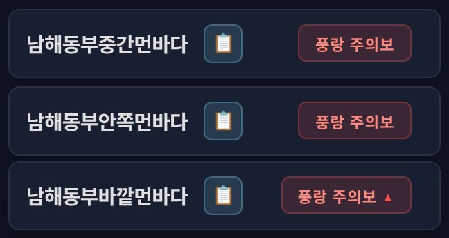
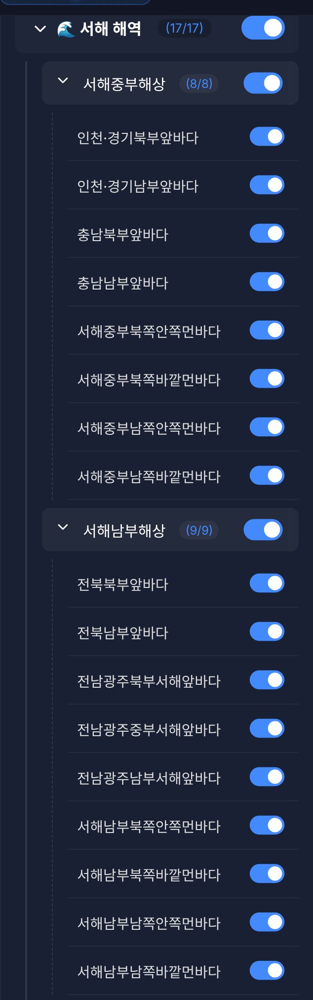
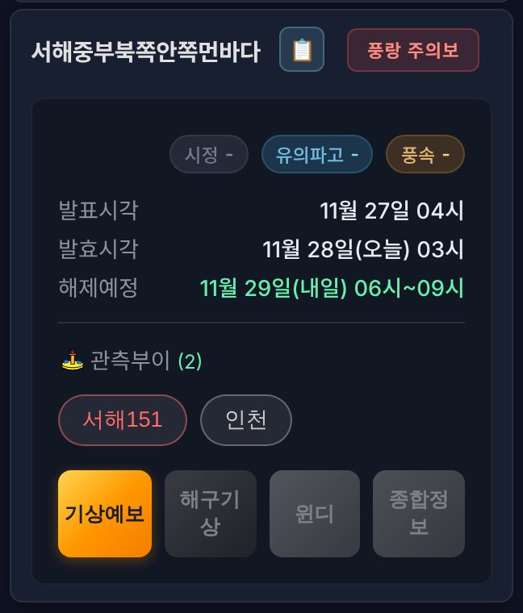

<!-- 패치노트 원본(작성 규칙: 저장소 NOTICE.md). 게시판에 올릴 파일은 `node scripts/notice/build_notice.js` 로 만든 patchnote.upload.md.
     범위: PR #1594(2026-11-28 머지 — 특보구역 2차 개편: 서해중부 먼바다 2→4 · 남해동부 먼바다 2→3 · 전남→전남광주 보이는 이름) +
       앞서 알리지 않은 제주 후속 PR #1592·#1593(11-27 — 새 두 구역 카드 「기상예보」 열기 · 중기예보를 「제주도해상」 값으로).
     근거(코드·실측 확인): client/js/core/zone_split.design.md 「2차 개편」 절 · config/zone_split.js SPLIT2*(늘 적용) ·
       MMIS warn/list 2026-11-28 실측(서해중부 새 4코드 풍랑주의보 28일 00:00 발표 — 그전엔 우리 앱이 못 읽음) ·
       날씨누리 특보(종합) GIS 지도 wrnArea.geojson(특보구역 48개) · /api/warn-zones 48개(운영 15:2x KST 확인) ·
       회색 버튼 3개 + 기상예보·관측부이 열림(render.js·windy.js isPending) · 문구 MSG_BUTTON(zone_split.js) ·
       남해동부안쪽 이어받기 = 새 앱 표시 없는 구독만(legacyExpand) · 저장값 이어받기 · 「전남광주」는 보이는 이름만(DISPLAY_RENAME).
       배포 직후 지금 걸린 특보는 다시 푸시되지 않는다(설계서 정정 절) → 글에 「업데이트 전 발표된 특보는 알림이 가지 못했다」.
     사진 6장(2026-11-28 15:3x KST 운영 앱 seagnal-server.fly.dev, 390×844·2배): 00 해양종합정보 특보구역 지도(서해중부·남해동부 확대) ·
       01 특보정보 「해역별 특보현황」 서해 칸 새 4구역 · 02 펼친 카드(버튼) · 03 회색 버튼 안내 · 04 남해동부 3구역 · 05 설정 → 관심해역 서해(새 이름·전남광주).
       지도 배경은 이번엔 나왔다. 가짜 자료 없음(방문·설문·사용 기록·구독 요청만 막고 찍음). -->
# 서해중부·남해동부 먼바다 특보구역 변경 안내

기상청이 **서해중부 먼바다와 남해동부 먼바다를 더 잘게 나눴어요.** SEA:GNAL도 새 구역에 맞춰 바뀌었어요.

## 📌 1. 무엇이 바뀌었나요?

### 서해중부 먼바다: 2곳 → 4곳

- 「안쪽·바깥먼바다」가 **북쪽·남쪽**으로 한 번 더 나뉘었어요.
  - 서해중부북쪽안쪽먼바다 · 서해중부남쪽안쪽먼바다
  - 서해중부북쪽바깥먼바다 · 서해중부남쪽바깥먼바다

### 남해동부 먼바다: 2곳 → 3곳

- **남해동부중간먼바다**가 새로 생겼어요.
- 남해동부안쪽먼바다는 이름은 그대로지만, **해안 쪽으로 좁아졌어요.**
- 남해동부바깥먼바다는 그대로예요.

### 「전남」 앞바다 이름이 「전남광주」로

- 예: 전남북부서해앞바다 → **전남광주북부서해앞바다**
- 구역 모양은 그대로이고, 이름만 바뀌었어요(5곳).

## 📍 2. 어디서 보나요?

- **특보정보** 탭의 해역별 특보현황·기상현황에 새 구역 카드가 나와요.

- **해양종합정보** 지도의 특보구역도 새 경계로 그려져요.
- 해상 특보구역은 모두 **48곳**이 됐어요.

## 🔔 3. 알림은 이렇게 돼요

- 새 구역도 다른 해역과 똑같이 **특보 푸시 알림**을 보내 드려요.
- ==따로 설정하지 않아도 이어받아요.==
  - 서해중부안쪽(바깥)먼바다 → 북쪽·남쪽 두 구역
  - 남해동부안쪽먼바다 → 안쪽 + 중간
- 기존 구역 알림을 꺼 두셨다면 새 구역도 꺼진 채로 이어져요.
- 설정의 **관심해역**에서 새 구역을 하나씩 켜고 끌 수 있어요.

- !!이번 업데이트 전에 새 구역에 발표된 특보는 알림이 가지 못했어요.!!
  - 지금 발효 중인 특보는 앱 화면에서 확인해 주세요.

## 🚧 4. 당분간 쓸 수 없는 기능

새로 나뉜 6곳(서해중부 4곳 · 남해동부 안쪽·중간)은 추가 정비가 끝날 때까지 일부 기능을 잠시 멈춰요.

- **해구기상 · 윈디 · 종합정보** 버튼은 **회색**이에요.
  - 누르면 「기상청 특보구역 변경에 따른 수정 진행 중입니다.」라고 안내해요.
- **시정 · 유의파고 · 풍속** 칸은 **「-」**로 보여요.
- ==기상예보·관측부이 버튼은 그대로 쓸 수 있어요.==

## 🌊 5. 제주도 바깥먼바다도 좋아졌어요

- 제주도남서쪽·남동쪽바깥먼바다 카드의 **기상예보** 버튼을 다시 쓸 수 있어요.
- 기상예보 창의 **중기예보**가 이제 「제주도해상」 값으로 나와요.
  - 전에는 남해서부 값이 보이고 있었어요.

> !!참고!! 구역이 바뀐 직후라 한동안 표시가 어긋날 수 있어요. 출항 전에는 기상청 특보 원문도 함께 확인해 주세요.
